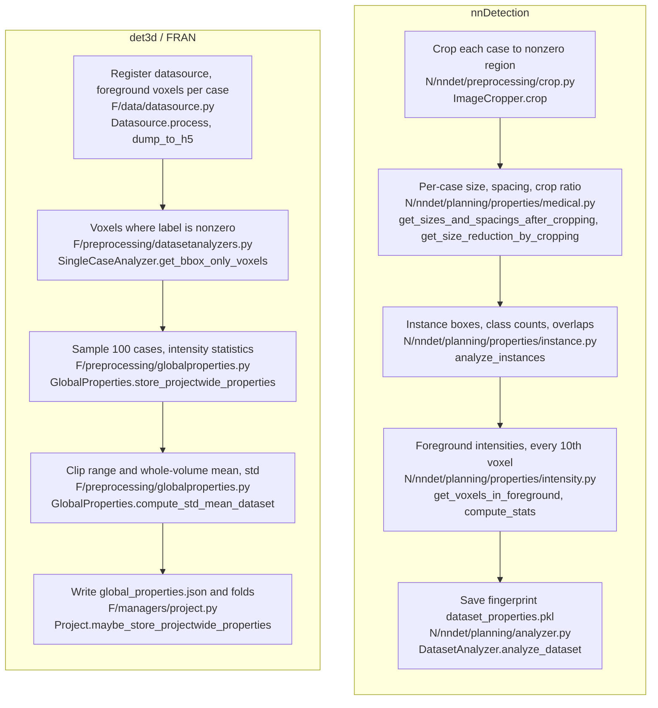

# Phase 1: data analysis

Index: [../nndetection-integration.md](../nndetection-integration.md). Upstream detail: [../nndetection-planning-algorithm.md](../nndetection-planning-algorithm.md) § Pipeline and artifacts.

Path prefixes: `N/` = `/home/ub/code/nnDetection/`, `F/` = `/home/ub/code/fran/fran/`, `D/` = `/home/ub/code/det3d/det3d/`.

The fingerprint is the only input to nnDetection planning. det3d's project-level file `/s/fran_storage/projects/lidca/global_properties.json` plays that role, with fewer fields.

## 1.1 Size, spacing and crop fingerprint

**nnDetection.** For every training case it records the cropped array size, the original voxel spacing and the ratio of cropped to uncropped volume. Planning takes percentiles of these.

**Rationale.** nnDetection follows nnU-Net in deriving its rule-based parameters from a dataset fingerprint: "we formulate explicit dependencies between the Data Fingerprint and design choices in the form of interdependent heuristic rules" (Baumgartner 2021, [nnDetection](https://arxiv.org/abs/2106.00817), Sec. 2, Rule-based Parameters). The fingerprint records image sizes before and after cropping because cropping "reduced the image size of brain datasets such as D1 (Brain Tumor) and D15 (MSLes) substantially and thus improved computational efficiency" (Isensee 2021, [nnU-Net](https://arxiv.org/abs/1904.08128), Methods, Dataset fingerprints).

**det3d today.** Per-case spacing is stored as an attribute in each datasource's `fg_voxels.h5`, and its median as `spacing_median`. On `lidca` the stored median is `[0, 0, 0]`: `store_projectwide_properties` takes the median over an array with one row per case (393) of which only the sampled 100 are filled. No code reads the value. Resampled shapes (min, median, max) are written to `dataset_summary.json`, but only after resampling, when spacing is already fixed. There is no crop ratio because there is no nonzero crop.

**Home.** `GlobalProperties.store_projectwide_properties` in `F/preprocessing/globalproperties.py`: it already aggregates per-case attributes into `global_properties.json`.

**Feeds.** 2.1 target spacing, 2.2 axis order, 2.3 patch size.

**Issues in det3d code.** A3 in [issues.md](issues.md).

## 1.2 Instance box statistics

**nnDetection.** Before any planning it derives one box per lesion instance from the instance mask at original resolution, and stores box sizes, instance counts per class and overlaps between instances.

**Rationale.** "Compared to nnU-Net our Data Fingerprint additionally extracts information about object sizes" (Baumgartner 2021, [nnDetection](https://arxiv.org/abs/2106.00817), Sec. 2, Rule-based Parameters). Object sizes feed the anchor configuration, which the authors call "one of the most important design choices in medical object detection", and the trigger of the low-resolution model, which compares the 99.5th percentile of object sizes with the patch size (Baumgartner 2021, [nnDetection](https://arxiv.org/abs/2106.00817), Sec. 2 and Fig. 1).

**det3d today.** Boxes first appear in preprocessing stage B (`DetectionBBoxStatsd`), at the plan spacing, as rows in `bboxes/<case>.csv`. Nothing reads those rows to produce size percentiles or class totals. `PlanAdvisorDet.suggest` in `D/configs/parser.py` looks for boxes in `<project>/detection/fold0/bboxes/*.json`, a folder that does not exist for `lidca`, so it has no data.

**Home.** No natural home before preprocessing: boxes do not exist until a spacing has been chosen and stage B has run. The nearest existing step at original resolution is `Datasource.process` in `F/data/datasource.py`, which already calls label_analysis `end2end_lms_stats_and_plots` to write per-lesion statistics. What the step does: one pass over raw label maps giving, per lesion, its box size in voxels and millimetres and its class, then dataset totals.

**Feeds.** 2.7 anchors, 2.3 patch memory estimate (lesions per patch), 2.9 low-resolution trigger.

## 1.3 Foreground intensity statistics

**nnDetection.** Takes every tenth voxel inside any lesion over all cases and stores mean, standard deviation and the 0.5th and 99.5th percentiles.

**Rationale.** For CT, nnU-Net normalises with foreground statistics because "intensity values are quantitative and reflect physical properties of the tissue. It can therefore be beneficial to retain this information by using a global normalization scheme that is applied to all images" (Isensee 2021, [nnU-Net](https://arxiv.org/abs/1904.08128), Methods, Intensity normalization). The fingerprint therefore holds the mean, standard deviation and 0.5 and 99.5 percentiles of the foreground voxels (Isensee 2021, [nnU-Net](https://arxiv.org/abs/1904.08128), Methods, Dataset fingerprints). This reason is stated for nnU-Net only (inherited by nnDetection).

**det3d today.** Same statistics (`mean_fg`, `std_fg`, `intensity_percentile_005_995_fg`) over all lesion voxels of at most 100 randomly sampled cases (seed 42). On `lidca`: clip range `[-973, 429]`, mean −142.7, standard deviation 285.6. The detection pipeline reads only the clip range.

**Home.** Exists: `GlobalProperties.store_projectwide_properties`.

**Feeds.** 3.4 intensity normalisation.

**Issues in det3d code.** C5 in [issues.md](issues.md).

## 1.4 Modality and normalisation scheme

**nnDetection.** Reads the modality name of each channel. A name containing `CT` selects clip-and-standardise with dataset statistics; any other name selects per-case standardisation, optionally inside the nonzero mask when the crop removed more than a quarter of the volume.

**Rationale.** nnU-Net uses per-image z-scoring as the default ("a good default") and deviates "only for CT images, where a global normalization scheme is determined based on the intensities found in foreground voxels across all training cases" (Isensee 2021, [nnU-Net](https://arxiv.org/abs/1904.08128), Supplement B.2, Intensity normalization). The nonzero mask is used for normalisation when cropping reduced the average image size by 25% or more (Isensee 2021, [nnU-Net](https://arxiv.org/abs/1904.08128), Methods, Intensity normalization). The rule is stated for nnU-Net only (inherited by nnDetection).

**det3d today.** `n_input_channels = 1` is typed in the sheet. One normalisation is applied to every project.

**Home.** No natural home. What the step does: a per-channel label ("CT" or not) stored with the dataset and read when the normalisation transform is built.

**Feeds.** 3.4 intensity normalisation.
