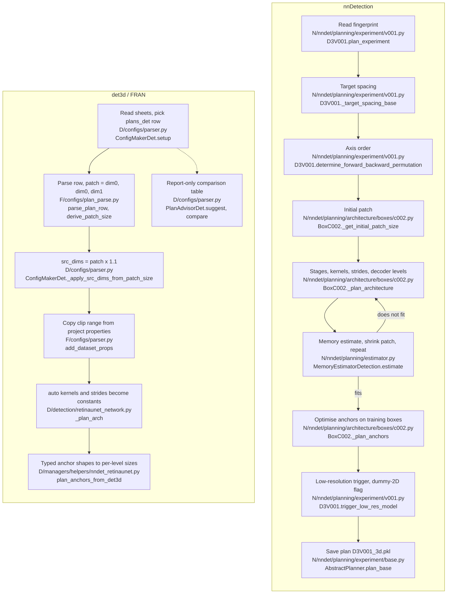

# Phase 2: experiment planning

Index: [../nndetection-integration.md](../nndetection-integration.md). Upstream detail for every group here: [../nndetection-planning-algorithm.md](../nndetection-planning-algorithm.md).

Path prefixes: `N/` = `/home/ub/code/nnDetection/`, `F/` = `/home/ub/code/fran/fran/`, `D/` = `/home/ub/code/det3d/det3d/`. Sheet = `/home/ub/code/fran/configurations/experiment_configs_det.xlsx`.

det3d has no stage that computes plan values from data. The one planning-shaped component is `PlanAdvisorDet` (`D/configs/parser.py`, CLI `D/run/planning/advise_det_plan.py`): it returns the typed spacing and patch, constant kernels and strides, and fixed anchors, and nothing reads its output. It is named below as the home wherever a value would be computed.

## 2.1 Target spacing

**nnDetection.** Median spacing per axis over all training cases. If one axis is more than three times coarser than the others and also has few slices, that axis uses the 10th percentile of its spacings instead. `D3V001._target_spacing_base`.

**Rationale.** "Larger spacings result in smaller images and thus a loss of details whereas smaller spacings result in larger images preventing the network from accumulating sufficient contextual information since the patch size is limited by the given GPU memory budget", so nnU-Net takes the per-axis median spacing (Isensee 2021, [nnU-Net](https://arxiv.org/abs/1904.08128), Methods, Target spacing). For anisotropic data the median "can result in severe interpolation artifacts or in a substantial loss of information due to large variances in resolution", so the coarse axis uses the 10th percentile when both voxel and spacing anisotropy exceed 3 (same section). The nnDetection code states "Same as nnUNet v21" for this rule (MIC-DKFZ, [v001.py](https://github.com/MIC-DKFZ/nnDetection/blob/main/nndet/planning/experiment/v001.py), `_target_spacing_base`).

**det3d today.** `plans_det` cell: `(0.8, 0.8, 1.5)`. A second, different spacing sits in `data_params` (`[0.703125, 0.703125, 1.25]`) and is not read on this path. The saved nnDetection plan for LIDC chose `[2, 0.703125, 0.703125]` (coarse axis first).

**Home.** `PlanAdvisorDet.suggest`. Needs 1.1.

**Feeds.** 2.2–2.4, 2.7, 3.3. The spacing is also part of the preprocessed folder name (`FolderNames`), so a new value means a new stage A and stage B build.

**Issues in det3d code.** B5 in [issues.md](issues.md).

## 2.2 Axis order

**nnDetection.** Sorts axes so the coarsest comes first and stores the permutation and its inverse. Every later array, spacing, kernel and anchor uses that order; inference undoes it. `D3V001.determine_forward_backward_permutation`.

**Rationale.** The nnDetection paper and code state no reason for this axis order; the code only labels it "z, y, x" ([v001.py](https://github.com/MIC-DKFZ/nnDetection/blob/main/nndet/planning/experiment/v001.py), `determine_forward_backward_permutation`). For the analogous transpose in nnU-Net, which puts the highest-resolution axes last, the nnU-Net documentation gives: "the 2D U-Net operates on the trailing dimensions (more efficient slicing due to internal memory layout of arrays)" (nnU-Net documentation, [plans-file documentation](https://github.com/MIC-DKFZ/nnUNet/blob/master/documentation/explanation_plans_files.md), transpose_forward). Reason stated for nnU-Net only.

**det3d today.** Fixed RAS x, y, z from `Orientationd` in stage A. Patch, anchors and kernels are written in x, y, z. Nothing is stored because nothing varies.

**Home.** No natural home; the order is implicit in `Orientationd(axcodes="RAS")` in `F/preprocessing/fixed_spacing.py`. What the step does: it only matters when values are exchanged with nnDetection (for example reading the saved plan, whose spacing, patch and anchors are coarse-axis first).

## 2.3 Patch size and memory fit

**nnDetection.** Starts from a patch that is roughly cubic in millimetres, capped by the median resampled image size. It builds the network, measures training memory at batch 4 with an estimated number of lesions per patch, and while that exceeds the target (an 11 GB card) shrinks the axis that is largest relative to the image, replans kernels and strides, and measures again. `BoxC002._get_initial_patch_size`, `BoxC002._plan_architecture`, `MemoryEstimatorDetection`.

**Rationale.** nnU-Net prioritises large patches because "Larger patch sizes allow for more contextual information to be aggregated and thus typically increase segmentation performance", at the cost of a smaller batch size and "noisier gradients" (Isensee 2021, [nnU-Net](https://arxiv.org/abs/1904.08128), Methods, Adaptation of network topology, patch size and batch size). nnDetection fixes the batch size at 4 "as we found this to improve training stability" (Baumgartner 2021, [nnDetection](https://arxiv.org/abs/2106.00817), Sec. 2, Rule-based Parameters). Its planner clips the initial patch to the median image shape "because patches larger then that make not much sense" (code comment, MIC-DKFZ, [boxes/base.py](https://github.com/MIC-DKFZ/nnDetection/blob/main/nndet/planning/architecture/boxes/base.py), `_get_initial_patch_size`).

**det3d today.** `patch_dim0`, `patch_dim1` cells → `[128, 128, 64]` (102 × 102 × 96 mm at plan spacing). GPU memory is not consulted. Batch size 4 is a `data_params` cell. On LIDC nnDetection arrived at the same `[128, 128, 64]` voxel count, at a different spacing and axis order.

**Home.** `PlanAdvisorDet.suggest` (it already carries a `patch_size` field). Needs 1.1, 1.2, 2.1.

**Feeds.** 2.4, 2.5, stage B minimum crop shape, extended-box columns, shard folder tag.

## 2.4 Stage count, kernels and strides

**nnDetection.** For the chosen spacing and patch it decides, per axis, how many times the network can halve the feature map before it drops below 4 voxels. A coarse axis gets kernel size 1 and is not downsampled until the other axes have caught up with its spacing. The number of stages follows from that. `BoxC001.plan_pool_and_conv_pool_late`.

**Rationale.** The depth must match the patch: "The network architecture needs to be adapted to the size and spacing of the input patches seen during training. This is necessary to ensure that the receptive field of the network covers the entire input", and downsampling continues until the feature maps reach 4 x 4 (x 4) "to ensure sufficient context aggregation" (Isensee 2021, [nnU-Net](https://arxiv.org/abs/1904.08128), Supplement B.2, Dynamic Network adaptation). For anisotropic data, pooling first acts in-plane and the out-of-plane kernel is 1 "to prevent aggregation of information across distant slices" (same section). Stated for nnU-Net; nnDetection uses the same iterative optimisation process (Baumgartner 2021, [nnDetection](https://arxiv.org/abs/2106.00817), Sec. 2).

**det3d today.** `encoder_conv_kernels = auto` and `encoder_strides = auto` resolve to constants in `_plan_arch`: five stages of `[3,3,3]` kernels, one `[1,1,1]` stride followed by four `[2,2,2]`. nnDetection's `Encoder` expects one stride fewer than kernels and reads entry `stage − 1`, so the leading `[1,1,1]` leaves the second stage at full resolution and the last entry is never read: the built network downsamples three times (strides 1, 1, 2, 4, 8). Identical for every dataset and spacing. The saved LIDC plan has six stages.

**Home.** `_plan_arch` in `D/detection/retinaunet_network.py`, the function that resolves `auto`. Needs 2.1, 2.3.

**Feeds.** 2.5, 2.7 (anchor scaling per level), divisibility of the patch.

**Issues in det3d code.** A1 in [issues.md](issues.md).

## 2.5 Decoder levels

**nnDetection.** The detection head reads up to four decoder levels, starting no finer than the third stage and ending at the coarsest. With six stages on LIDC: levels `(2, 3, 4, 5)`, about 1.0 million anchors per patch.

**Rationale.** The Retina U-Net authors attach the detection heads to fine decoder levels because "in the existence of small object sizes in medical images, we shift sub-network operations by one pyramid level towards P2-P5", which "comes at a computational price, since a vast number of dense positions are produced in the higher resolution P2 level" (Jaeger 2020, [Retina U-Net](https://arxiv.org/abs/1811.08661), Sec. 3.1). nnDetection states that its planner adapts the feature pyramid levels to the memory limit (Baumgartner 2021, [nnDetection](https://arxiv.org/abs/2106.00817), Fig. 1); no reason is stated for the specific rule of four levels starting no finer than the third stage.

**det3d today.** `decoder_levels` cell `(1, 2, 3, 4)`. The typed value equals nnDetection's rule for five stages, but with the stride offset of 2.4 the detection levels sit at strides 1, 2, 4, 8, so the first level is at full patch resolution and carries 12.6 million of the 14.4 million anchors per patch (measured by building the model).

**Home.** `_plan_arch`, with 2.4.

**Issues in det3d code.** A1 in [issues.md](issues.md).

## 2.6 Channel widths

**nnDetection.** Constants in the planner: 32 channels at the first stage, doubling to a cap of 320; feature pyramid and head 128. Not data-dependent.

**Rationale.** "As a tradeoff between performance and memory consumption, the initial number of feature maps is set to 32 and doubled (halved) with each downsampling (upsampling) operation. To limit the final model size, the number of feature maps is additionally capped at 320 and 512 for 3D and 2D U-Nets, respectively" (Isensee 2021, [nnU-Net](https://arxiv.org/abs/1904.08128), Methods, Blueprint parameters). Stated for nnU-Net (inherited by nnDetection); no reason is stated for the head width of 128.

**det3d today.** Same values: 32 / 320 typed, pyramid and head computed as 4 × 32.

**Home.** Exists.

## 2.7 Anchors

**nnDetection.** Takes all training boxes at target spacing, discards the extreme 0.5% at each end, and searches for three sizes per axis that maximise the mean best overlap between boxes and anchors (three runs of a differential-evolution optimiser). Every position gets the 3 × 3 × 3 = 27 combinations, and sizes are multiplied by each level's stride. `BoxC002._plan_anchors`, `AnchorGenerator3DS`.

**Rationale.** nnDetection maximises the IoU between anchors and ground-truth boxes following Zlocha et al., and runs the optimisation on the training split because this "led to more robust anchor configurations due to a higher number of samples" (Baumgartner 2021, [nnDetection](https://arxiv.org/abs/2106.00817), Sec. 2, Rule-based Parameters). On DeepLesion, replacing RetinaNet default anchors by anchors from a differential-evolution search raised sensitivity at 0.5 false positives per image from 45.80 to 64.82 (Zlocha 2019, [RetinaNet with dense masks](https://arxiv.org/abs/1906.02283), Table 1). Increasing the number of anchors per position from one to 27 "improves results especially on data sets with few objects" (Baumgartner 2021, [nnDetection](https://arxiv.org/abs/2106.00817), Sec. 2, Fixed Parameters). With ATSS as matcher, "the dependence on very accurate anchors sizes is slightly reduced" (nnDetection maintainer, [issue 243](https://github.com/MIC-DKFZ/nnDetection/issues/243)).

**det3d today.** `base_anchor_shapes` cell: `[[6,8,4],[8,6,5],[10,10,6]]`, in voxels. On the `retinaunet` path `plan_anchors_from_det3d` turns them into `sizes (8,8,10,10)`, `zsizes (4,5,6,6)` with three aspect ratios. The generator gives every level all four z sizes, so each position has 12 anchors (9 distinct), and the in-plane size is 8 on the first two levels and 10 on the last two regardless of stride. On the `retinanet` path there are 3 anchors per position, scaled by 1, 2, 4.

**Home.** Computation: `PlanAdvisorDet.suggest`, which already has an anchor field. Hand-off to the model: `plan_anchors_from_det3d` in `D/managers/helpers/nndet_retinaunet.py`. Needs 1.2, 2.1, 2.4.

**Issues in det3d code.** A4, A5 in [issues.md](issues.md).

## 2.8 Dummy-2D flag

**nnDetection.** If the patch's longest side is more than three times its shortest, rotations and elastic deformation are applied slice by slice in the plane of the fine axes only. The saved LIDC plan sets it.

**Rationale.** In nnU-Net, spatial augmentation for anisotropic patches (longest edge at least three times the shortest) is applied in 2D (Isensee 2021, [nnU-Net](https://arxiv.org/abs/1904.08128), Supplement D). For an anisotropic dataset the stated reason is that "spatial augmentations for the 3D U-Net (such as scaling and rotation) are done in-plane only to prevent resampling of imaging information across slices which would cause interpolation artifacts" (Isensee 2021, [nnU-Net](https://arxiv.org/abs/1904.08128), Supplement C.1, ACDC). Stated for nnU-Net (inherited by nnDetection).

**det3d today.** None. Rotation ranges are typed per axis in the base workbook (`affine3d`).

**Home.** No natural home. What the step does: one boolean derived from the patch shape, read by the spatial augmentation (4.5).

## 2.9 Low-resolution plan

**nnDetection.** If the largest 0.5% of boxes exceed the patch on any axis, a second plan at twice the spacing is written. No upstream code trains it or combines its predictions, and the standard configuration always selects the full-resolution plan.

**Rationale.** nnDetection triggers the low-resolution model "to account for otherwise missing context in data sets with very large objects or high resolution images" (Baumgartner 2021, [nnDetection](https://arxiv.org/abs/2106.00817), Sec. 2, Rule-based Parameters). In nnU-Net, running on downsampled data "increases the size of patches in relation to the image and thus enables the network to accumulate more contextual information", at the cost of detail in small targets (Isensee 2021, [nnU-Net](https://arxiv.org/abs/1904.08128), Methods, Configuration of 3D U-Net cascade).

**det3d today.** None.

**Home.** No natural home. What the step does: a warning that some lesions do not fit in one patch.
