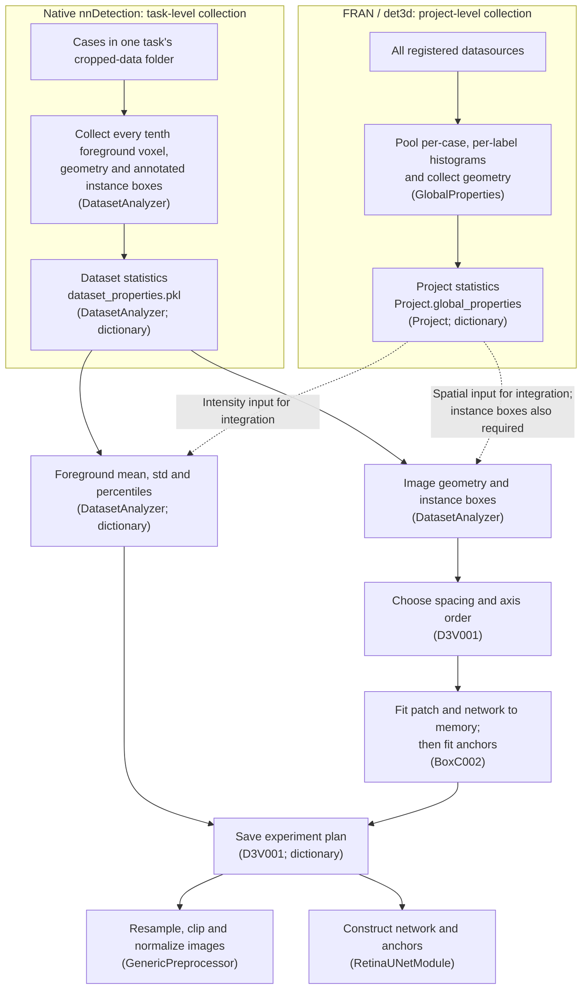
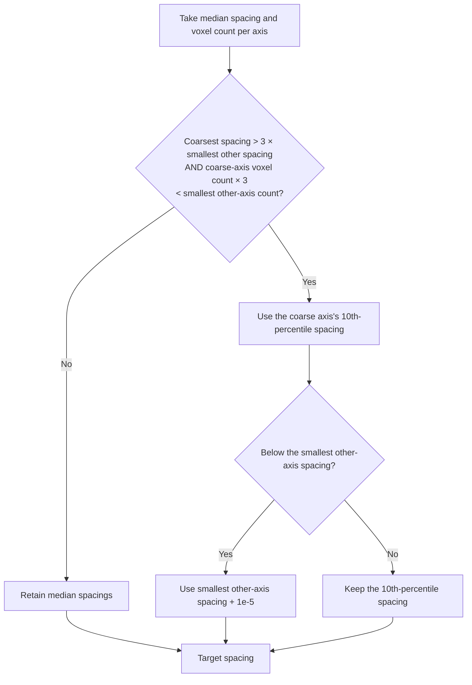
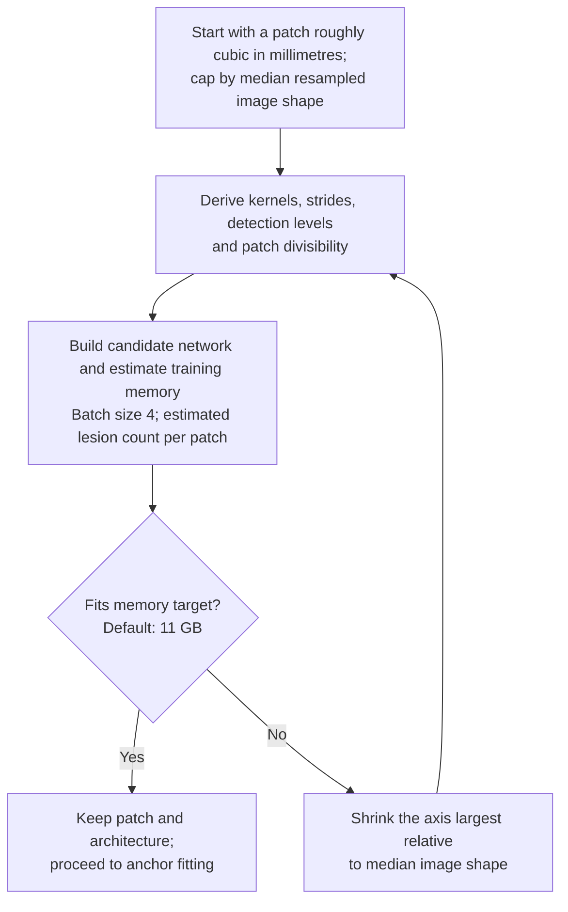
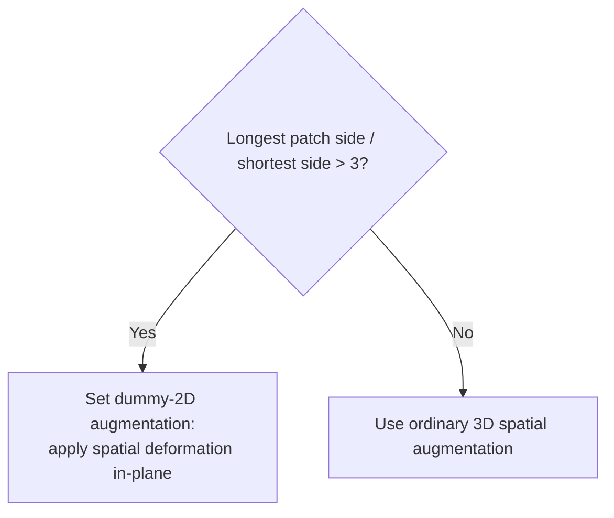
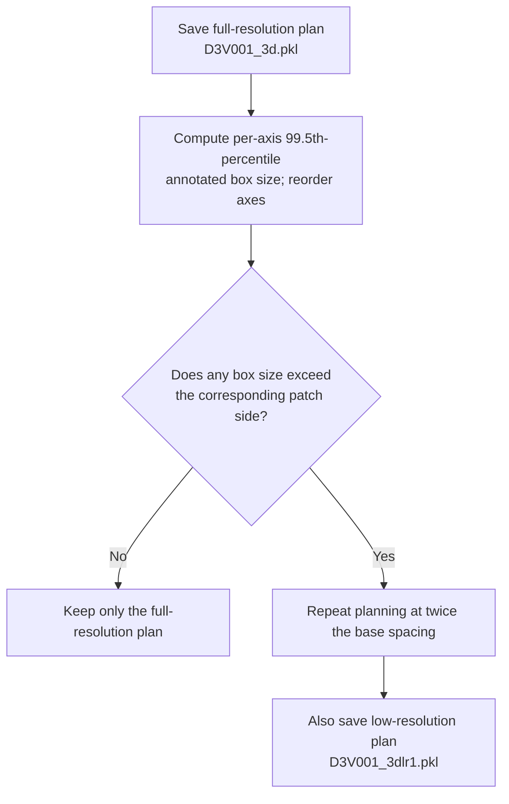

# Phase 2: experiment planning

[Pipeline index](../nndetection-integration.md) · [Agreed integration scope](MAIN.md) · [Detailed upstream algorithm](../nndetection-planning-algorithm.md)

## Data flow and ownership

Class headings name the owner; `method()` denotes a callable; `name` without parentheses denotes a variable or dictionary key.

## nnDetection objects

### DatasetAnalyzer — class

1. Collect cropped image sizes, spacings and crop-size reductions across the task's cases.
2. Collect instance boxes, class mappings, counts and overlaps.
3. Pool every tenth foreground voxel per case and channel; compute global and per-case intensity statistics.
4. Combine analysis-function results and save `dataset_properties.pkl` (`analyze_dataset()`).

### dataset_properties — dictionary

- `dim`
- `all_sizes`
- `all_spacings`
- `size_reductions`
- `modalities`
- `class_dct`
- `all_classes`
- `instance_props_per_patient`
- `num_instances`
- `class_ious`
- `all_ious`
- `intensity_properties`

### intensity_properties[channel_id] — dictionary

- `median`
- `mean`
- `std`
- `min`
- `max`
- `percentile_00_5`
- `percentile_99_5`
- `local_props[case_id]`

### D3V001 — class

1. Choose target spacing (`determine_target_spacing()`) and axis order (`determine_forward_backward_permutation()`); [2.1–2.2](#21-target-spacing).
2. Select normalization scheme and masking per channel (`determine_normalization()`, `determine_whether_to_use_mask_for_norm()`; inherited from `AbstractPlanner`).
3. Compute median image shape at target spacing; call `BoxC002` with shape, spacing and axis order (`AbstractPlanner.plan_base_stage()`, `create_architecture_planner()`).
4. Merge architecture, anchors and dataset statistics into the plan (`AbstractPlanner.plan_base()`, `AbstractPlanner.plan_base_stage()`).
5. Set the dummy-2D flag (`AbstractPlanner.plan_base_stage()`); decide whether to generate a second plan at twice the spacing (`trigger_low_res_model()`); [2.8–2.9](#28-dummy-2d-flag).
6. Save the plan (`AbstractPlanner.save_plan()`); create `GenericPreprocessor` from its settings (`create_preprocessor()`).

### BoxC002 — class

1. Set input-channel and class counts (`process_properties()`); compute class weights (`BaseBoxesPlanner.compute_class_weights()`).
2. Set 3D defaults: batch size 4; encoder channels 32–320; pyramid/head channels 128 (`create_default_settings()`).
3. Compute patch size, stage count, kernels and strides; shrink and repeat until the network fits memory (`_plan_architecture()`, with `MemoryEstimatorDetection.estimate()`); [2.3–2.4](#23-patch-size-and-memory-fit).
4. Select detection levels: six stages → `(2, 3, 4, 5)` (`_plan_architecture()`); [2.5](#25-decoder-levels).
5. Fit anchor sizes: three sizes per axis → **27 anchors per feature-map position** in 3D; scale sizes by detection level (`_plan_anchors()`); [2.7](#27-anchors).
6. Return dictionary keys `patch_size`, `batch_size`, `architecture` and `anchors` (`plan()`, via `BoxC001.plan()`).

### Experiment plan — dictionary

- `mode`
- `target_spacing`
- `normalization_schemes`
- `use_mask_for_norm`
- `anisotropy_threshold`
- `resample_anisotropy_threshold`
- `target_spacing_percentile`
- `dim`
- `num_modalities`
- `all_classes`
- `num_classes`
- `transpose_forward`
- `transpose_backward`
- `dataset_properties`
- `planner_id`
- `network_dim`
- `dataloader_kwargs`
- `data_identifier`
- `postprocessing`
- `patch_size`
- `batch_size`
- `architecture`
- `anchors`
- `target_spacing_transposed`
- `median_shape_transposed`
- `do_dummy_2D_data_aug`
- `trigger_lr1` (full-resolution plan)

### GenericPreprocessor — class

1. Reorder axes and resample images and masks to planned spacing (`transpose()`, `resample()`).
2. For standard CT normalization, clip to foreground percentiles 0.5–99.5 and apply `(image - foreground_mean) / foreground_std` using `dataset_properties["intensity_properties"]` for each channel (`normalize_ct()`).
3. Apply the planned normalization mask (`normalize_ct()`) and save preprocessed data and supporting properties (`run_process()`).

### RetinaUNetModule — class

1. Build the network from the planned architecture (`from_config_plan()`).
2. Build the anchor generator from fitted per-level anchor sizes (`from_config_plan()`).

## FRAN / det3d objects

### GlobalProperties — class

1. Collect cases (`collate_project_cases()`, called from `Project.maybe_store_projectwide_properties()`) across the project's registered datasources; sample up to 100 case IDs by default, or all with `max_cases=None`. Sampling does not guarantee every datasource is represented.
2. Pool per-case, per-label histograms (`_pooled_histogram()`); compute `mean_fg`, `std_fg` and foreground percentiles (`store_projectwide_properties()`).
3. Collect spatial properties (`_retrieve_h5_properties()`) and compute median spacing (`store_projectwide_properties()`).
4. Compute `mean_dataset_clipped` and `std_dataset_clipped` (`compute_std_mean_dataset()`); select one image row per sampled case for patch sources (`filter_img_fnames_for_sampling()`).
5. Store results in `Project.global_properties` (`store_projectwide_properties()`, `compute_std_mean_dataset()`).

## 2.1 Target spacing

`D3V001`

Resample each case's shape to this spacing and take the median shape. Pass spacing and median shape to `BoxC002`. Spacing changes also require rebuilding FRAN's spacing-dependent preprocessing outputs.

**det3d:** spacing comes from `plans_det`; automatic spacing selection remains a separate candidate from the assigned `BoxC002` integration.

## 2.2 Axis order

`D3V001`

Move the coarsest axis first, retain the other axes' relative order, and save the inverse permutation. Apply the same order to shapes, spacing, boxes, kernels and anchors; undo it during inference.

**det3d:** stage A uses RAS x, y, z. Convert axis order consistently when exchanging nnDetection plans and properties.

## 2.3 Patch size and memory fit

`BoxC002`

**det3d:** patch and batch sizes are workbook inputs; GPU memory is not consulted. Patch size also determines minimum crop shape, extended boxes and shard folder tags.

## 2.4 Stage count, kernels and strides

`BoxC002`

For each axis, downsample while the feature map can remain at least 4 voxels wide. Delay downsampling a coarse axis until the finer axes approach its spacing; use kernel size 1 along that axis while it remains coarse. Derive stage count and patch divisibility from the resulting downsampling sequence.

**det3d:** `auto` currently resolves to fixed kernels and strides in `retinaunet_network._plan_arch`. The leading stride entry conflicts with nnDetection's inter-stage stride convention; see [A1](issues.md). The assigned integration replaces this with the upstream planner's output.

## 2.5 Decoder levels

`BoxC002`

For `n` stages, start at `min(max(1, n - 4), 2)` and use every level through `n - 1`. Six stages therefore select `(2, 3, 4, 5)`. These feature maps feed the detection heads and determine anchor locations.

**det3d:** levels are typed in the workbook. Consume planned levels together with planned strides; the current stride mismatch puts the first detection level at full patch resolution ([A1](issues.md)).

## 2.6 Channel widths

`BoxC002`

Start with 32 channels, double per downsampling stage up to 320; feature pyramid and detection head use 128 channels. These are fixed 3D defaults, not dataset-derived decisions.

**det3d:** uses the same values.

## 2.7 Anchors

`BoxC002`

Transform annotated boxes to the selected spacing and axis order → filter box-size extremes outside the 0.5th–99.5th percentiles → fit three sizes per axis to maximize mean best box–anchor IoU. Run differential evolution three times and retain the best result. Combine sizes into 27 anchors per position in 3D and scale sizes for each detection level's stride.

**det3d:** workbook shapes currently pass through `plan_anchors_from_det3d` on the RetinaUNet path; the RetinaNet path has a separate conversion. The assigned `BoxC002` integration consumes fitted anchors with their level scaling. See [A4/A5](issues.md).

## 2.8 Dummy-2D flag

`D3V001`

**det3d:** rotation ranges are workbook inputs; there is no corresponding automatic flag.

## 2.9 Low-resolution plan

`D3V001`

The trigger compares stored box voxel sizes directly with patch sizes; it does not rescale boxes to target spacing. Generating the extra plan does not automatically train or combine a second model. A low-resolution workflow remains outside the assigned first integration.

Implementation locations: nnDetection `nndet/planning/experiment/{base,v001}.py`, `nndet/planning/architecture/boxes/{base,c002}.py`, `nndet/preprocessing/preprocessor.py`; FRAN `fran/managers/project.py`, `fran/preprocessing/globalproperties.py`; det3d `det3d/configs/parser.py`, `det3d/detection/retinaunet_network.py`, `det3d/managers/helpers/nndet_retinaunet.py`.
