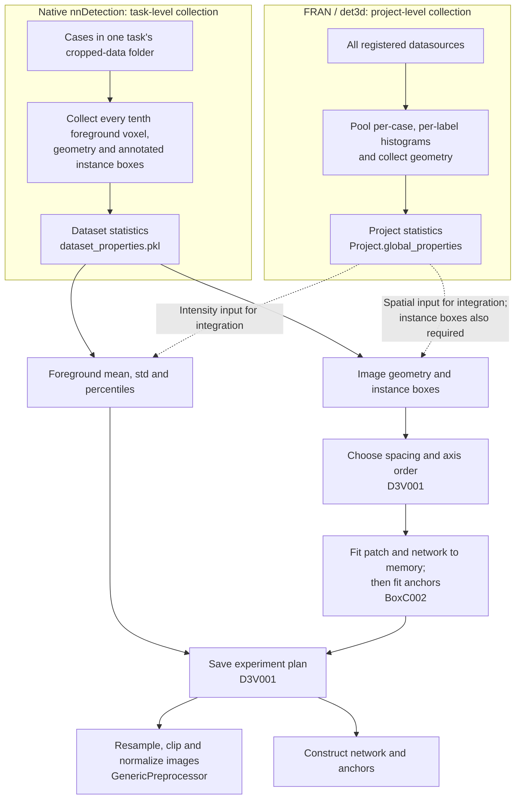
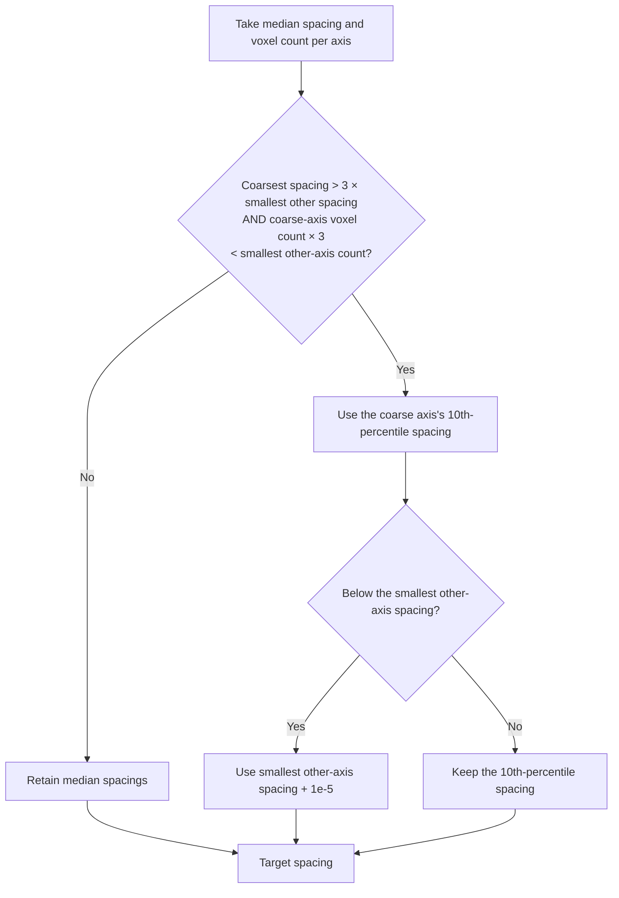
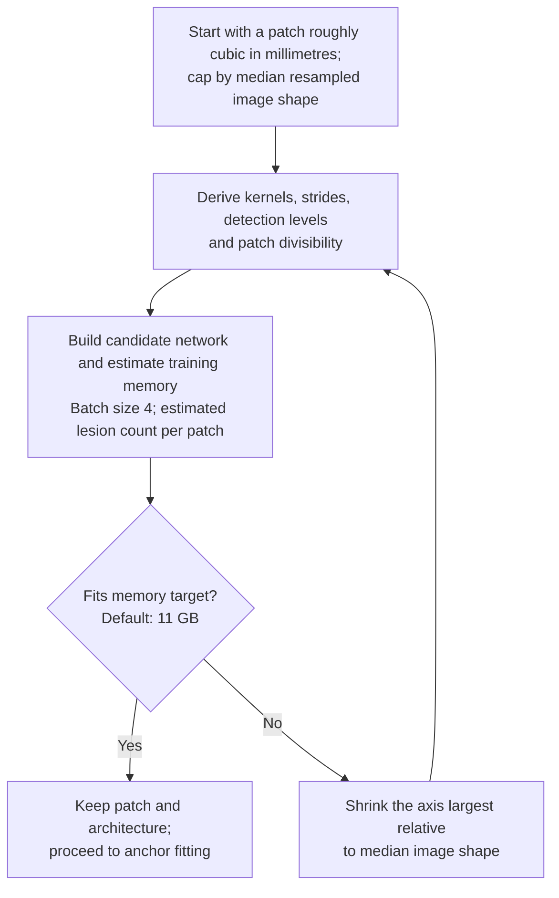
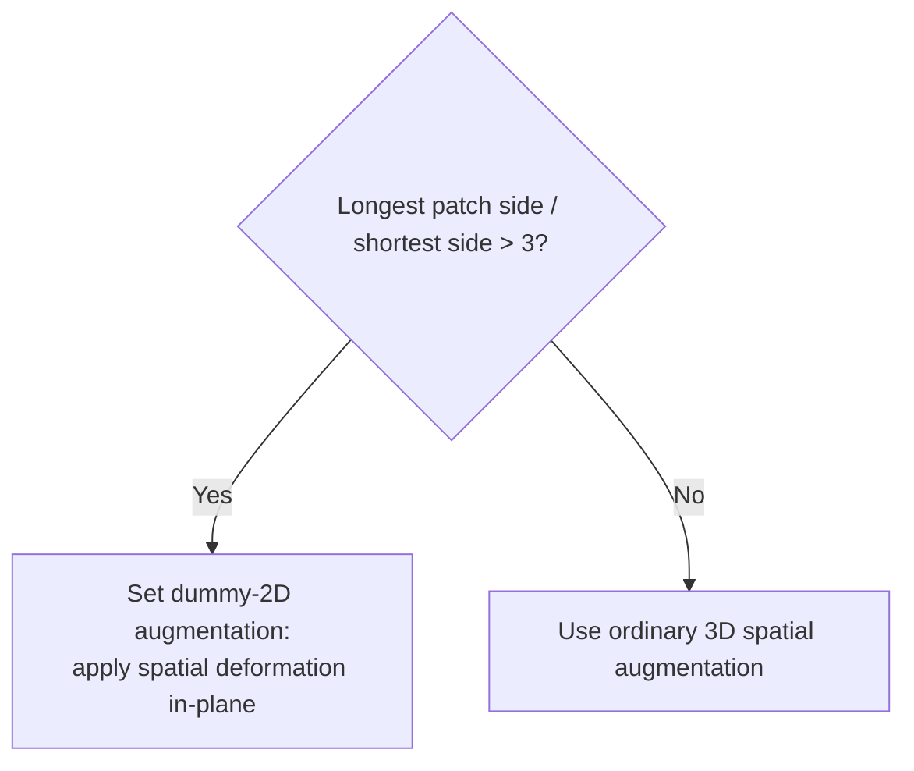
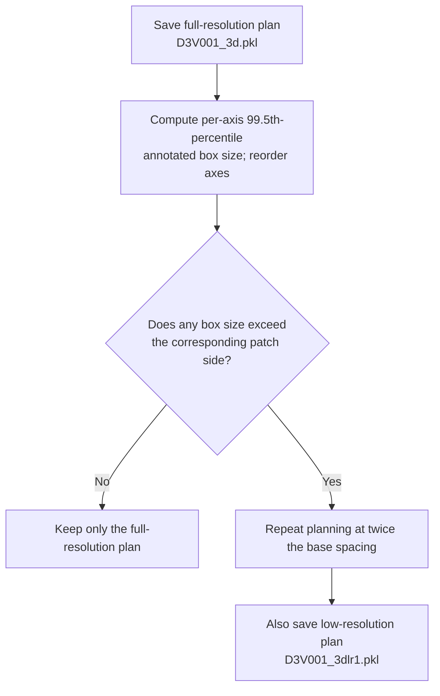

# Phase 2: experiment planning

[Pipeline index](../nndetection-integration.md) · [Agreed integration scope](MAIN.md) · [Detailed upstream algorithm](../nndetection-planning-algorithm.md)

## Data flow and ownership



FRAN starts at `Project.maybe_store_projectwide_properties()` → `GlobalProperties`. It considers all registered datasources, but defaults to sampling **100 cases across the combined project**; each datasource is not guaranteed representation. Set `max_cases=None` to include all case IDs. Patch sources select one image row per sampled case for whole-image statistics.

FRAN stores both foreground `mean_fg` / `std_fg` from pooled histograms and whole-image `mean_dataset_clipped` / `std_dataset_clipped` after clipping. Native nnDetection CT normalization uses **foreground** mean and std:

```python
image = (clip(image, foreground_p0_5, foreground_p99_5) - foreground_mean) / foreground_std
```

Statistics are stored per image channel in `plan["dataset_properties"]["intensity_properties"]`; `D3V001.create_preprocessor()` passes them to `GenericPreprocessor`. `BoxC002` consumes spatial and instance properties, rather than these normalization values.

## 2.1 Target spacing

**Where:** outer experiment planner (`D3V001`).



Resample each case's shape to this spacing and take the median shape. Pass spacing and median shape to `BoxC002`. Spacing changes also require rebuilding FRAN's spacing-dependent preprocessing outputs.

**det3d:** spacing comes from `plans_det`; automatic spacing selection remains a separate candidate from the assigned `BoxC002` integration.

## 2.2 Axis order

**Where:** outer experiment planner (`D3V001`). Move the coarsest axis first, retain the other axes' relative order, and save the inverse permutation. Apply the same order to shapes, spacing, boxes, kernels and anchors; undo it during inference.

**det3d:** stage A uses RAS x, y, z. Convert axis order consistently when exchanging nnDetection plans and properties.

## 2.3 Patch size and memory fit

**Where:** architecture planner (`BoxC002`) with `MemoryEstimatorDetection`.



**det3d:** patch and batch sizes are workbook inputs; GPU memory is not consulted. Patch size also determines minimum crop shape, extended boxes and shard folder tags.

## 2.4 Stage count, kernels and strides

**Where:** inside the architecture/memory loop (`BoxC001.plan_pool_and_conv_pool_late`, inherited by `BoxC002`).

For each axis, downsample while the feature map can remain at least 4 voxels wide. Delay downsampling a coarse axis until the finer axes approach its spacing; use kernel size 1 along that axis while it remains coarse. Derive stage count and patch divisibility from the resulting downsampling sequence.

**det3d:** `auto` currently resolves to fixed kernels and strides in `retinaunet_network._plan_arch`. The leading stride entry conflicts with nnDetection's inter-stage stride convention; see [A1](issues.md). The assigned integration replaces this with the upstream planner's output.

## 2.5 Decoder levels

**Where:** inside the same architecture/memory loop (`BoxC002`). For `n` stages, start at `min(max(1, n - 4), 2)` and use every level through `n - 1`. Six stages therefore select `(2, 3, 4, 5)`. These feature maps feed the detection heads and determine anchor locations.

**det3d:** levels are typed in the workbook. Consume planned levels together with planned strides; the current stride mismatch puts the first detection level at full patch resolution ([A1](issues.md)).

## 2.6 Channel widths

**Where:** architecture planner defaults. Start with 32 channels, double per downsampling stage up to 320; feature pyramid and detection head use 128 channels. These are fixed 3D defaults, not dataset-derived decisions.

**det3d:** uses the same values.

## 2.7 Anchors

**Where:** after the patch/network memory loop (`BoxC002._plan_anchors`).

Transform annotated boxes to the selected spacing and axis order → filter box-size extremes outside the 0.5th–99.5th percentiles → fit three sizes per axis to maximize mean best box–anchor IoU. Run differential evolution three times and retain the best result. Combine sizes into 27 anchors per position in 3D and scale sizes for each detection level's stride.

**det3d:** workbook shapes currently pass through `plan_anchors_from_det3d` on the RetinaUNet path; the RetinaNet path has a separate conversion. The assigned `BoxC002` integration consumes fitted anchors with their level scaling. See [A4/A5](issues.md).

## 2.8 Dummy-2D flag

**Where:** outer planner, after architecture planning.



**det3d:** rotation ranges are workbook inputs; there is no corresponding automatic flag.

## 2.9 Low-resolution plan

**Where:** outer planner, after the full-resolution architecture plan.



The trigger compares stored box voxel sizes directly with patch sizes; it does not rescale boxes to target spacing. Generating the extra plan does not automatically train or combine a second model. A low-resolution workflow remains outside the assigned first integration.

Implementation locations: nnDetection `nndet/planning/experiment/{base,v001}.py`, `nndet/planning/architecture/boxes/{base,c002}.py`, `nndet/preprocessing/preprocessor.py`; FRAN `fran/managers/project.py`, `fran/preprocessing/globalproperties.py`; det3d `det3d/configs/parser.py`, `det3d/detection/retinaunet_network.py`, `det3d/managers/helpers/nndet_retinaunet.py`.
