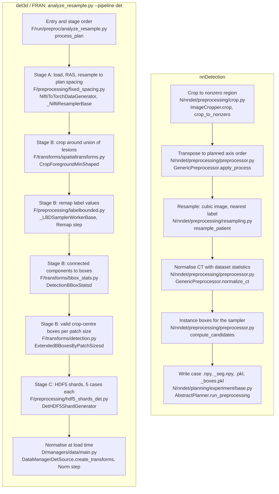

# Phase 3: preprocessing

Index: [../nndetection-integration.md](../nndetection-integration.md). Upstream detail: [../nndetection-planning-algorithm.md](../nndetection-planning-algorithm.md) § Spacing, orientation and normalization.

Path prefixes: `N/` = `/home/ub/code/nnDetection/`, `F/` = `/home/ub/code/fran/fran/`, `D/` = `/home/ub/code/det3d/det3d/`.

## 3.1 Crop

**nnDetection.** Removes only the all-zero border of the image and remembers the offset. On CT, where air is about −1000 and not 0, this removes almost nothing. The whole scan is kept, so every region of every scan can supply training patches.

**Rationale.** In nnU-Net, cropping to the nonzero region "had no effect on most datasets in our experiments, it reduced the image size of brain datasets such as D1 (Brain Tumor) and D15 (MSLes) substantially and thus improved computational efficiency" (Isensee 2021, [nnU-Net](https://arxiv.org/abs/1904.08128), Methods, Dataset fingerprints). Stated for nnU-Net (inherited by nnDetection).

**det3d today.** Stage B makes one crop per case: the bounding box of all lesions together, grown to at least the patch size and shifted to stay inside the scan (`expand_by = 0`). The crop is taken from the label map before remapping, so raw label 1, which plan 4 maps to background, sets its extent. On `lidca` that label is organ-sized: crops keep a median 39% of the resampled scan (median 354 × 246 × 180 voxels) and none is as small as the patch. The historical plan 4 run excluded empty targets. Fresh runs include preprocessed empty targets in random training slots (`data_params.nnz_allowed = 1`). Inference uses a lung crop from the localiser with a 10 mm margin.

**Home.** Stage B, `CropForegroundMinShaped` in `_LBDSamplerWorkerBase` (`F/preprocessing/labelbounded.py`).

**Issues in det3d code.** C4 in [issues.md](issues.md).

## 3.2 Transpose

**nnDetection.** Reorders image, label, spacing and boxes to the planned axis order (2.2) as the first processing step.

**Rationale.** The nnDetection paper and code state no reason for the transpose. For nnU-Net, which puts the highest-resolution axes last, the documentation gives: "the 2D U-Net operates on the trailing dimensions (more efficient slicing due to internal memory layout of arrays)" (nnU-Net documentation, [plans-file documentation](https://github.com/MIC-DKFZ/nnUNet/blob/master/documentation/explanation_plans_files.md), transpose_forward). Reason stated for nnU-Net only.

**det3d today.** Stage A reorients every case to RAS.

**Home.** Stage A, `Orientationd` in `_NiftiResamplerBase` (`F/preprocessing/fixed_spacing.py`). Tied to 2.2.

## 3.3 Resampling

**nnDetection.** Cubic interpolation for the image, nearest neighbour for the label, all axes together. nnU-Net's rule of resampling a coarse axis separately is present in the called function but switched off: nnDetection passes `force_separate_z=False`, which fixes it to off whatever the anisotropy threshold says.

**Rationale.** nnDetection uses "the same image resampling procedure as nnU-Net" (Baumgartner 2021, [nnDetection](https://arxiv.org/abs/2106.00817), Fig. 1). nnU-Net resamples because "Convolutional neural networks operate on voxel grids and ignore this information" about voxel spacing; for anisotropic images (axis spacing ratio above 3) the out-of-plane axis is treated differently because this "suppresses resampling artifacts, as large contour changes between slices are much more common" (Isensee 2021, [nnU-Net](https://arxiv.org/abs/1904.08128), Methods, Resampling). That out-of-plane rule is nnU-Net's; nnDetection's code switches it off, and no reason is stated for doing so.

**det3d today.** Stage A: `Spacingd` trilinear for the image, nearest for the label, all axes together, then the label is resized to the image shape.

**Home.** Stage A, the `SpImg`, `SpLm` steps of `_NiftiResamplerBase`.

## 3.4 Intensity normalisation

**nnDetection.** For CT: clip to the dataset's 0.5th and 99.5th foreground percentiles, subtract the foreground mean, divide by the foreground standard deviation. Done once, written to disk.

**Rationale.** For CT, nnU-Net clips to foreground percentiles and normalises with global foreground statistics because "intensity values are quantitative and reflect physical properties of the tissue. It can therefore be beneficial to retain this information" (Isensee 2021, [nnU-Net](https://arxiv.org/abs/1904.08128), Methods, Intensity normalization). Stated for nnU-Net (inherited by nnDetection).

**det3d today.** Preprocessed files hold raw Hounsfield units. At load time `ScaleIntensityRanged` clips to the same percentile pair (`[-973, 429]` on `lidca`) and rescales linearly to 0–1. The stored `mean_fg` and `std_fg` are not used. Inference applies the same clip and rescale from the checkpoint's saved configuration (`D/inference/patch.py`, `create_preprocess_transforms`).

**Home.** The `Norm` step in `DataManagerDetSource.create_transforms` (`D/managers/data/main.py`) for training and validation, and `create_preprocess_transforms` for inference. Needs 1.3, 1.4.

## 3.5 Instances and ground-truth boxes

**nnDetection.** Input labels are instance masks: each lesion has its own id, and a per-case map gives each id a class. Preprocessing keeps the instance mask and stores one box per instance for the patch sampler. Training boxes are derived later from the mask (4.6).

**Rationale.** Retina U-Net uses the segmentation mask because converting pixel-wise annotations to boxes "entails information loss which contradicts the need for data-efficient training on comparably small data sets" (Jaeger 2020, [Retina U-Net](https://arxiv.org/abs/1811.08661), Sec. 1). On 3D lung CT (LIDC-IDRI), Retina U-Net reached mAP10 49.8% against 45.9% for RetinaNet without the segmentation supervision; on breast diffusion MRI the values were 35.8% and 31.9% (Jaeger 2020, [Retina U-Net](https://arxiv.org/abs/1811.08661), Tables 1 and 2). The nnDetection authors state that bounding boxes store less information than pixel-wise segmentation, which "limits the use of spatial data augmentation transformations and available training signals" (Baumgartner 2023, [Mediastinal lesions with nnDetection](https://arxiv.org/abs/2303.11214), Sec. 1).

**det3d today.** Input labels are semantic. After remapping (`{1:0, 2:1, 3:1, 4:2, 5:3, 6:3}` on plan 4), `DetectionBBoxStatsd` takes connected components per label value as instances, drops components whose major axis is under 2.0 mm (a code default; no sheet cell) or that are flat, and writes boxes as `xyzxyz` voxel coordinates in `bboxes/<case>.csv`. These stored boxes are the training targets. Two lesions of the same class that touch become one instance. The `ignore_labels_cc` sheet column does not reach this path.

**Home.** Stage B, `DetectionBBoxStatsd` (`F/transforms/bbox_stats.py`) with `DetectionLabelMapGeometryPT` (`D/geometry/lmg.py`).

**Feeds.** 4.3 sampling, 4.6 boxes after augmentation, 5.2 segmentation target.

**Issues in det3d code.** B1, C1, D6 in [issues.md](issues.md).

