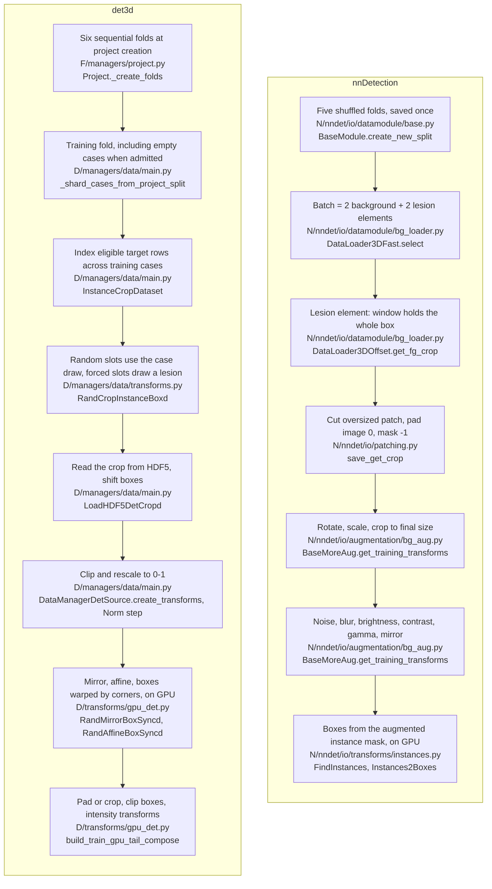

# Phase 4: data loading and augmentation

Index: [../nndetection-integration.md](../nndetection-integration.md).

Path prefixes: `N/` = `/home/ub/code/nnDetection/`, `F/` = `/home/ub/code/fran/fran/`, `D/` = `/home/ub/code/det3d/det3d/`.

## 4.1 Splits

**nnDetection.** Five folds from a shuffled split of the sorted case ids with a fixed seed, created the first time training starts and saved as `splits_final.pkl`. An existing file is used as is.

**Rationale.** nnDetection trains "via five-fold cross-validation" and builds the final prediction "by ensembling the predictions of the five models" (Baumgartner 2021, [nnDetection](https://arxiv.org/abs/2106.00817), Sec. 2, nnDetection application); the empirical parameters are optimised on the validation sets (same section). In nnU-Net, "Thanks to the cross-validation, nnU-Net can use the entire training set for validation and ensembling" (Isensee 2021, [nnU-Net](https://arxiv.org/abs/1904.08128), Supplement C.1, ACDC), and the cross-validation is needed "to be able to determine the postprocessing" (Isensee, [common questions](https://github.com/MIC-DKFZ/nnUNet/blob/nnunetv1/documentation/common_questions.md)). No reason is stated for shuffling or the seed.

**det3d today.** `Project._create_folds(pct_valid=0.15)` makes six sequential folds without shuffling when the project is created. On `lidca` the folds hold 101, 99, 98, 137, 158 and 160 cases.

**Home.** `Project._create_folds` in `F/managers/project.py`.

**Issues in det3d code.** D1 in [issues.md](issues.md).

## 4.2 Epoch length

**nnDetection.** The loader draws patches at random with replacement. An epoch is defined as 2,500 training batches and 100 validation batches, independent of dataset size. The schedule (5.4) counts iterations on that basis: 50 epochs = 125,000 iterations.

**Rationale.** nnDetection fixes the schedule at 60 epochs of 2500 mini-batches (Baumgartner 2021, [nnDetection](https://arxiv.org/abs/2106.00817), Fig. 1); no reason is stated for these numbers. For nnU-Net, "Based on experience and as a trade-off between runtime and reward, all networks are trained for 1000 epochs with one epoch being defined as iteration over 250 minibatches" (Isensee 2021, [nnU-Net](https://arxiv.org/abs/1904.08128), Methods, Training schedule). The nnU-Net author states "The whole concept of epoch is kind of obsolete in patch based training" and "You can never guarantee the network sees all of the training data because of the way the patches are sampled (randomly)" (Isensee, [issue 61](https://github.com/MIC-DKFZ/nnUNet/issues/61)).

**det3d.** A fixed iteration budget draws cases with replacement. A full-pass epoch shuffles the case indices once. Both use the same forced-slot rule on the resulting batch, including a shorter final batch.

**Home.** The training `DataLoader` built in `DataManagerDetSource` (`D/managers/data/main.py`).

## 4.3 Patch sampling

**nnDetection.** With a batch of four and 50% foreground sampling, two patches use random locations. Each of the other two draws a lesion uniformly from the training split, so scans with more lesions contribute more forced patches. `DataLoader3DFast.get_fg_crop` centres the patch on a uniformly drawn integer point inside the tight box for lesions of every size.

**Rationale.** In nnU-Net, "Oversampling is implemented to ensure robust handling of class imbalances", with 33.3% of patches guaranteed to contain a foreground class (Isensee 2021, [nnU-Net](https://arxiv.org/abs/1904.08128), Methods, Training schedule). Rare classes "could end up being ignored because they are underrepresented during training", and the oversampling is limited so that the network also sees the variability of the background (Isensee 2021, [nnU-Net](https://arxiv.org/abs/1904.08128), Supplement B.1). nnDetection forces half of each batch to contain at least one object (Baumgartner 2021, [nnDetection](https://arxiv.org/abs/2106.00817), Fig. 1); the nnU-Net reasons are inherited, and no separate reason is stated for the 1:1 ratio or the placement of the lesion inside the patch.

**det3d.** H09 applies to fresh source, LBD and RBD training. The final slots of each batch draw independently from a flat list of eligible training lesions, with replacement. The list uses remapped, size-filtered target rows and respects the plan's ignored and foreground-excluded labels. LIDC SOTA forces two of four slots. Random slots retain the uniform case draw and random location. A blank fraction uses the existing per-patch probability from `fgbg_ratio`.

**Placement.** H09 uses the same integer draw on each axis, from the lower edge of the det3d box up to, and excluding, its upper edge. Boxes larger than the patch are eligible. At scan edges the crop keeps its origin and pads outside the scan. Before augmentation, the selected row's box must overlap the unpadded crop by at least one voxel. A fully covered box in an instance map must contain its row ID. A partial crop can intersect an empty corner of a valid box. Missing overlap raises with the case ID and one-based lesion row. After augmentation, the tracker clips a surviving chosen box and drops it if it fails the tracker's usual retention rules. Either outcome can continue training. Historical detection checkpoints keep case-first sampling. [Setting and resume behaviour](../../../fran/fran/docs/oversample_fg.md)

**Implementation.** `InstanceCropDataset` in `D/managers/data/main.py` and `RandCropInstanceBoxd` in `D/managers/data/transforms.py`.

## 4.4 Oversized patch

**nnDetection.** The loader cuts a patch larger than the final one, sized so that a rotation of up to 30° and a zoom-out to 0.7 still leave real image everywhere in the final window: `[128,128,64]` becomes `[249,204,170]`. Spatial augmentation then resamples and crops to the final size. Image padding is 0, mask padding is −1.

**Rationale.** In nnU-Net, "Sampled patches are initially larger than the patch size used for training. This results in less out of boundary values (here 0) being introduced during data augmentation when rotation and scaling is applied" (Isensee 2021, [nnU-Net](https://arxiv.org/abs/1904.08128), Supplement D). The nnDetection maintainer states: "The extracted patch size is bigger than the training patch size to avoid border artefacts during the augmentation step" (Baumgartner, [issue 67](https://github.com/MIC-DKFZ/nnDetection/issues/67)).

**det3d today.** The crop is read at final size and the affine is applied to it, so rotated or shrunk samples are filled at the borders. A `prezoom_scale` mechanism (`patch_size_prezoom`, extended-box columns at 1.1, 1.2, 1.4 times the patch) exists and is set to 1.0.

**Home.** `prezoom_scale` in dataset parameters, consumed by the training crop and `ResizeWithPadOrCropBoxSyncd`.

**Issues in det3d code.** A6 in [issues.md](issues.md).

## 4.5 Augmentation set

| Transform | nnDetection (`BaseMoreAug`) | det3d (`build_train_gpu_tail_compose`) |
|---|---|---|
| Rotation | p 0.2, ±30° on each axis | inside affine: p 0.3, about ±11°, ±11°, ±9° |
| Scaling | p 0.2, one factor 0.7–1.4 | inside affine: ±15% per axis |
| Elastic | off | none |
| Mirror | each of three axes, p 0.5 | each configured axis independently (workbook axes 0, 1, 2, p 0.5) |
| Gaussian noise | p 0.1 | p 0.1 |
| Gaussian blur | p 0.2, sigma 0.5–1.0 | p 0.15, sigma 0.5–1.0 |
| Brightness (multiplicative) | p 0.15, 0.75–1.25 | scale intensity p 0.1 |
| Contrast | p 0.15, 0.75–1.25 | none |
| Gamma | p 0.3, 0.7–1.5 | p 0.1 (0.7–1.3) and p 0.15 (0.7–1.5) |
| Inverted gamma | p 0.1 | none |
| Intensity shift | none | p 0.1 |

**Rationale.** nnDetection uses "the same augmentation strategy as nnU-Net without simulating low resolution samples" (Baumgartner 2021, [nnDetection](https://arxiv.org/abs/2106.00817), Fig. 1); no reason is stated for dropping the low-resolution simulation. nnU-Net states: "Data augmentation is essential to achieve state of the art performance. It is important to run the augmentations on the fly and with associated probabilities to obtain a never ending stream of unique examples" (Isensee 2021, [nnU-Net](https://arxiv.org/abs/1904.08128), Supplement B.1). The nnDetection authors later reduced rotation for a task with coarse box annotations because rotations that are not multiples of 90 degrees are "troublesome when coarse annotations are used during training since the axis aligned bounding boxes can not be derived without introducing localization errors" (Baumgartner 2023, [Mediastinal lesions with nnDetection](https://arxiv.org/abs/2303.11214), Sec. 2.1).

nnDetection leaves 64% of samples spatially untouched (neither rotation nor scaling fires). Its intensity transforms act on standardised values; det3d's act on 0–1 values.

**Home.** `build_train_gpu_tail_compose` in `D/transforms/gpu_det.py`; probabilities and ranges come from `transform_factors` and `affine3d` in the base workbook plus two constants in code.

**Issues in det3d code.** D4 in [issues.md](issues.md).

## 4.6 Boxes after augmentation

**nnDetection.** The instance mask goes through the same spatial transform as the image. After augmentation, on the GPU, each surviving instance id gives a box from its remaining voxels (min − 1 to max + 1). A lesion partly outside the patch gets a truncated box that matches what is visible; a lesion rotated out vanishes.

**Rationale.** The nnDetection authors state that with segmentation masks carried through the data loading pipeline "we can use spatial transformations from commonly available data augmentation frameworks ... to artificially diversify the data" (Baumgartner 2023, [Mediastinal lesions with nnDetection](https://arxiv.org/abs/2303.11214), Sec. 2, Preprocessing). Rotations that are not multiples of 90 degrees "can be troublesome when coarse annotations are used during training since the axis aligned bounding boxes can not be derived without introducing localization errors" (Baumgartner 2023, [Mediastinal lesions with nnDetection](https://arxiv.org/abs/2303.11214), Sec. 2.1). The step of deriving boxes from the augmented instance mask is not itself justified in the nnDetection paper or repository.

**det3d today.** Stored boxes are transformed geometrically: the eight corners are warped and the axis-aligned envelope is taken, so a rotated box grows beyond the lesion. Boxes are then clipped to the patch. The label map is loaded and warped alongside the image on the `retinaunet` path (for the segmentation loss) but is not used for boxes.

**Home.** After `RandAffineBoxSyncd` in the GPU tail (`D/transforms/gpu_det.py`); the conversion to the model's box format is `det3d_batch_to_nndet` in `D/managers/helpers/nndet_retinaunet.py`. Depends on 3.5 (instance identity in the mask).

**Issues in det3d code.** D3 in [issues.md](issues.md).

## 4.7 Validation patches

**nnDetection.** Each epoch, 100 batches of freshly drawn patches from the validation cases, half lesion-forced and half random, no augmentation.

**Rationale.** No stated rationale found in the nnDetection paper, its supplement, repository or the nnU-Net paper.

**det3d today.** `valid_impl = bbox_anchor`: one patch per validation case centred on its first box; lesions outside that patch are not scored, and there are no lesion-free patches. An alternative `patch_stream` implementation that tiles whole volumes exists (`D/managers/data/valid_patch_stream.py`) and is not selected. In run-through mode there is no validation.

**Home.** `DataManagerDetLBD` validation chain (`BboxCenterCropSlicesd`) in `D/managers/data/main.py`.

**Issues in det3d code.** B6, D5 in [issues.md](issues.md).

