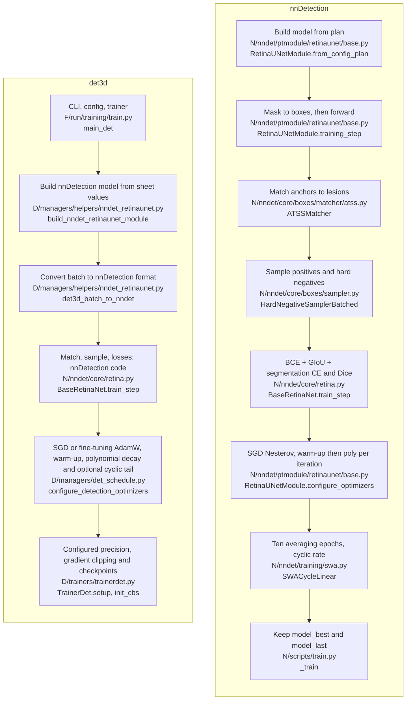

# Phase 5: model and training

Index: [../nndetection-integration.md](../nndetection-integration.md). Which sheet values reach the model: [../nndetection-config-audit-lidca.md](../nndetection-config-audit-lidca.md).

Path prefixes: `N/` = `/home/ub/code/nnDetection/`, `F/` = `/home/ub/code/fran/fran/`, `D/` = `/home/ub/code/det3d/det3d/`.

This phase compares the `retinaunet` path, which runs nnDetection's own model code. The sheet default `retinanet` (MONAI) shares the optimiser, schedule and trainer but has its own backbone, three anchors per position, SmoothL1 box loss and no segmentation head.

## 5.1 Matching and sampling

**nnDetection.** For each lesion, on each pyramid level, the anchors nearest its centre are candidates (4 × anchors per position). Candidates whose overlap with the lesion exceeds that lesion's own mean + standard deviation become positives. From the whole batch it then keeps up to 33% positives of a budget of 32 anchors per image, and fills the rest with negatives drawn from the highest-scoring (hardest) ones.

**Rationale.** nnDetection employs adaptive training sample selection "to account for varying network configurations and object sizes across data sets" (Baumgartner 2021, [nnDetection](https://arxiv.org/abs/2106.00817), Sec. 2, Fixed Parameters); the ATSS authors state that "different settings of these hyperparameters will have very different results" for fixed IoU thresholds, and ATSS raised RetinaNet from 37.0 to 39.3 AP on COCO minival (Zhang 2020, [ATSS](https://arxiv.org/abs/1912.02424), Sec. 4.1, Table 3). nnDetection discards the requirement that anchor centres lie inside the box because it "often resulted in the removal of all positive anchors for small objects", and uses 27 anchors per position, which it "found improves results especially on data sets with few objects" (Baumgartner 2021, [nnDetection](https://arxiv.org/abs/2106.00817), Sec. 2, Fixed Parameters). Negatives are mined "to account for the class-imbalance of object level classification losses" (Jaeger 2020, [Retina U-Net](https://arxiv.org/abs/1811.08661), Sec. 4.2). No stated rationale found for the 1/3 positive fraction.

**det3d today.** Same classes (`ATSSMatcher`, `HardNegativeSamplerBatched`). Sheet values replace the sampler numbers: 64 per image, positive fraction 0.3, at least 16 negatives. With 12 anchors per position (2.7) there are 48 candidates per level against 108 upstream.

**Home.** Exists; `apply_det3d_plan_to_nndet_model_cfg` in `D/configs/nndet_bridge.py` forwards the six fields.

**Issues in det3d code.** A4 in [issues.md](issues.md).

## 5.2 Losses

**nnDetection.** Classification: sigmoid cross-entropy on the sampled anchors (not focal). Box: generalised IoU on sampled positives. Auxiliary: a foreground-versus-background segmentation head on the full-resolution decoder map, trained with half cross-entropy and half Dice. All four terms are summed with weight 1.

**Rationale.** The segmentation head is added because coarse detection levels convert pixel annotations to boxes, an "information loss which contradicts the need for data-efficient training on comparably small data sets" (Jaeger 2020, [Retina U-Net](https://arxiv.org/abs/1811.08661), Sec. 1). On LIDC in 3D, Retina U-Net reached mAP at IoU 0.1 of 49.8 against 45.9 for RetinaNet without the segmentation loss, and on breast MRI in 3D 35.8 against 31.9; the soft Dice term "has been shown to stabilize training on highly class imbalanced segmentation tasks" (Jaeger 2020, [Retina U-Net](https://arxiv.org/abs/1811.08661), Sec. 3.1, Tables 1 and 2). For GIoU, plain IoU has zero gradient for non-overlapping boxes while GIoU "has a gradient in all possible cases"; with YOLOv3 on PASCAL VOC the IoU-based AP rose from .461 (MSE loss) to .477 (GIoU loss) (Rezatofighi 2019, [Generalized IoU](https://arxiv.org/abs/1902.09630), Sec. 3.1, Table 1), and nnDetection lists GIoU without a reason of its own (Baumgartner 2021, [nnDetection](https://arxiv.org/abs/2106.00817), Fig. 1). No stated rationale found for sigmoid cross-entropy rather than focal loss.

**det3d today.** Identical on `retinaunet`: the segmentation target is the label-map patch with every value above 0 set to 1. The sheet cells `cls_loss`, `reg_loss`, `w_cls`, `w_reg` are read only on the `retinanet` path.

**Home.** Exists.

**Issues in det3d code.** B2, C1 in [issues.md](issues.md).

## 5.3 Optimiser

**nnDetection.** SGD, learning rate 0.01, momentum 0.9, Nesterov, weight decay 3e-5 applied to all parameters except those of normalisation layers.

**Rationale.** No stated rationale found in the nnDetection paper, its supplement or repository for its optimiser settings. The method whose recipe nnDetection follows reports that "stochastic gradient descent with a high initial learning rate (0.01) and a large nesterov momentum (0.99) empirically provided the best results" (Isensee 2020, [Automated design of deep learning methods](https://arxiv.org/abs/1904.08128), Supplementary Information B); nnDetection uses momentum 0.9 (Baumgartner 2021, [nnDetection](https://arxiv.org/abs/2106.00817), Fig. 1). No stated rationale found for the weight-decay value or for excluding normalisation parameters.

**det3d today.** From scratch, `sota` uses Nesterov SGD with momentum 0.9 and workbook gradient clipping. With `pretrained=nnfoundation`, the detection fine-tuning sheet selects Nesterov SGD at 0.01 with gradient clipping off. Setting `finetuning.optimizer` to `adamw` selects the DETR + ResEnc recipe at 3e-4. Both optimizers exclude normalization parameters from weight decay.

**Home.** `configure_detection_optimizers` in `D/managers/det_schedule.py`.

**Issues in det3d code.** B3, B4 in [issues.md](issues.md).

## 5.4 Learning-rate schedule

**nnDetection.** Stepped every iteration. The rate rises linearly from 1e-6 to 0.01 over the first 4,000 iterations, then decays as `0.01 × (1 − progress)^0.9` with a horizon of 125,000 iterations. The callback swaps schedulers at the boundary described in §5.5. The schedule depends on the fixed epoch length of 4.2.

**Rationale.** nnDetection lists the 4,000-iteration linear warm-up, the poly schedule and 2,500 batches per epoch without a reason (Baumgartner 2021, [nnDetection](https://arxiv.org/abs/2106.00817), Fig. 1). nnU-Net, which nnDetection follows, defines an epoch as 250 training iterations and reports that "shorter trainings than this default empirically result in diminished segmentation performance", with a poly learning rate that is "an almost linear decrease to 0" (Isensee 2020, [Automated design of deep learning methods](https://arxiv.org/abs/1904.08128), Supplementary Information B). The nnDetection maintainer states that "training time should remain independent of the dataset size since the same number of batches/samples is sampled in each epoch" ([issue 208](https://github.com/MIC-DKFZ/nnDetection/issues/208)). No stated rationale found for the warm-up length.

**det3d today.** From scratch with `plans.swa_tail_fraction=auto`, the outer manager uses nnDetection’s `LinearWarmupPolyLR` over the pre-tail optimizer steps and `CycleLinear` for the tail. Zero selects full-run decay. The nnFoundation recipe warms up over 3.2% of total optimizer steps (4% with AdamW), then uses nnDetection’s per-step polynomial decay with exponent 0.9.

**Home.** `configure_detection_optimizers` in `D/managers/det_schedule.py`. Needs 4.2 (a known total iteration count).

## 5.5 Weight averaging

**nnDetection.** v001 configures 50 + 10 epochs. Lightning 1.4.2 interprets start epoch 50 as one-based, so the callback actually averages the starts of epochs 50 through 60. Each epoch’s rate rises from 1e-5 toward 1e-3 and resets. The end-of-training hooks transfer the average before saving `model_last`. [Lightning SWA](https://raw.githubusercontent.com/Lightning-AI/pytorch-lightning/1.4.2/pytorch_lightning/callbacks/stochastic_weight_avg.py) · [Checkpoint hooks](https://raw.githubusercontent.com/Lightning-AI/pytorch-lightning/1.4.2/pytorch_lightning/callbacks/model_checkpoint.py)

**Rationale.** nnDetection takes a weight snapshot after each epoch for Stochastic Weight Averaging and gives no reason of its own (Baumgartner 2021, [nnDetection](https://arxiv.org/abs/2106.00817), Fig. 1). The SWA authors report that "averaging of multiple points along the trajectory of SGD, with a cyclical or constant learning rate, leads to better generalization than conventional training" and finds "much flatter solutions than SGD" (Izmailov 2018, [Stochastic Weight Averaging](https://arxiv.org/abs/1803.05407), Abstract). Independent evidence: SWA over 12 extra epochs with cyclical rates improved several detectors (Mask R-CNN, Faster R-CNN, RetinaNet, FCOS, YOLOv3, VFNet) by about 1.0 AP on COCO (Zhang 2020, [SWA Object Detection](https://arxiv.org/abs/2012.12645), Introduction).

**det3d today.** Blank or `auto` disables averaging for nnFoundation fine-tuning. From scratch it selects one sixth of total epochs and aligns the transition to validation. A positive explicit fraction up to 1 must give a validation-aligned transition, and 0 disables averaging. The 60-epoch from-scratch recipe averages ten epoch-start parameter sets with the current normalization buffers.

**Home.** Shared callback list in fran `Trainer.init_cbs` (`fran/trainers/trainer.py`); `TrainerDet.init_cbs` (`D/trainers/trainerdet.py`) adds SWA.

**Issues in det3d code.** B8, D7 in [issues.md](issues.md).

## 5.6 Checkpoint choice

**nnDetection.** Saves `model_best` (highest validation metric, measured on 100 noisy random patches per epoch) and `model_last`. The sweep, consolidation and test prediction all use `model_last`; `model_best` is never loaded by default.

**Rationale.** No stated rationale found in the nnDetection paper, its supplement or repository.

**det3d today.** `TrainerDet`: top two by `val0_metric` every 5 epochs, plus permanent snapshots at the resolved quarter-run interval by default. With an enabled tail, best and permanent checkpoints retain the raw model, and `last.ckpt` contains averaged inference weights and separate raw resume weights. `TrainerDetRT` (the launchers' default): no validation, checkpoints by lowest training loss. Inference takes one checkpoint by run id.

**Home.** fran `Trainer.init_cbs`, with the monitor and cadence set by `TrainerDet` / `TrainerDetRT` class attributes; checkpoint lookup `checkpoint_from_model_id` used by `D/run/inference/infer_det.py`.

**Issues in det3d code.** C8 in [issues.md](issues.md).

## 5.7 Folds

**nnDetection.** One training run per fold (five; ten for LUNA16), each followed by its own sweep, then consolidation (6.7).

**Rationale.** nnDetection trains five folds and ensembles the five models for test prediction without stating a reason (Baumgartner 2021, [nnDetection](https://arxiv.org/abs/2106.00817), Sec. 2, nnDetection application). nnU-Net uses "the five networks obtained from our training set cross-validation as an ensemble to further increase the robustness of our models" (Isensee 2018, [nnU-Net](https://arxiv.org/abs/1809.10486), Sec. 2.4). Ten folds for LUNA16 follow the challenge rule that "participants are required to perform 10-fold cross-validation" on the provided data (Setio 2017, [LUNA16](https://arxiv.org/abs/1612.08012), Sec. 3.2).

**det3d today.** `--fold` selects one of the six project folds. The launchers `D/run/training/train_det.sh` and `local_train_det.sh` take a single `FOLD`. Nothing loops over folds or collects their outputs.

**Home.** No natural home. What the step does: run the same plan once per fold and keep the runs addressable as one group for 6.6 and 6.7.
