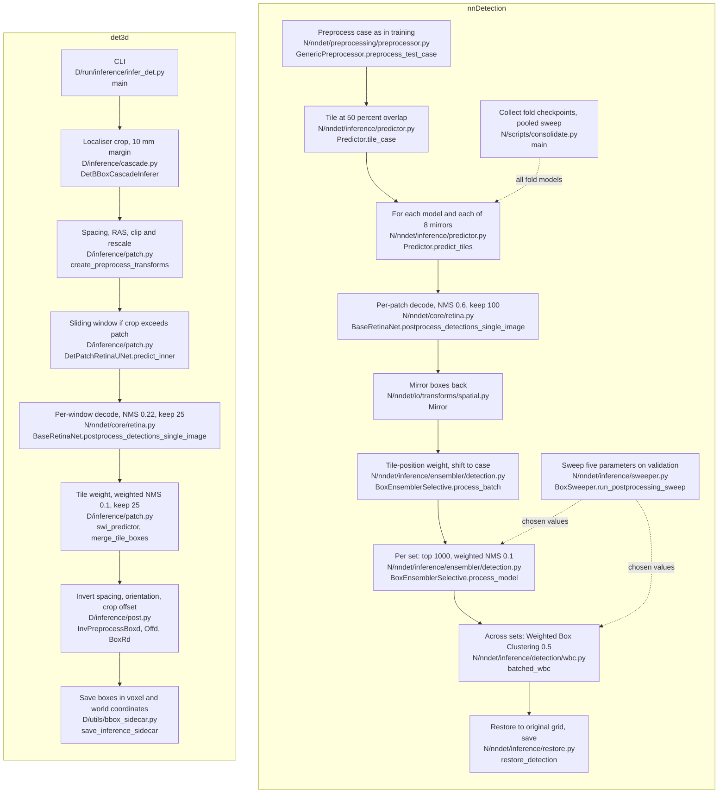

# Phase 6: inference, fusion and parameter sweep

Index: [../nndetection-integration.md](../nndetection-integration.md).

Path prefixes: `N/` = `/home/ub/code/nnDetection/`, `F/` = `/home/ub/code/fran/fran/`, `D/` = `/home/ub/code/det3d/det3d/`.

A "prediction set" below is all boxes from one model under one mirroring variant, over all tiles of a case.

## 6.1 Tiling

**nnDetection.** Every case is cut into patches of the training size with 50% overlap on each axis. The grid is placed symmetrically, so the first and last patches overhang the case equally, and overhanging patches are shifted back inside.

**Rationale.** "Due to limited GPU memory, nnDetection uses sliding window inference with overlapping patches" (Baumgartner 2021, [nnDetection](https://arxiv.org/abs/2106.00817), Sec. 2, Empirical Parameters). Retina U-Net states that tiling is designed "to avoid potential artifacts that arise due to effects at the patch boundaries (e.g. by allowing for sufficient overlap between patches)" (Jaeger 2020, [Retina U-Net](https://arxiv.org/abs/1811.08661), Sec. 3.2). nnU-Net spaces adjacent predictions by half a patch "to prevent stitching artifacts" (Isensee 2020, [Automated design of deep learning methods](https://arxiv.org/abs/1904.08128), Supplementary Information B). No stated rationale found for the symmetric grid placement.

**det3d today.** MONAI `SlidingWindowInferer` with overlap 0.2 (`infer_det.py`) or 0.25 (`infer_cascade.py`), used only when a side of the crop is larger than the patch; smaller crops go through the network whole. On `retinanet` the overlap is a plan value (0.25) and the command-line overlap does not reach it.

**Home.** `DetPatchRetinaUNet.predict_inner` in `D/inference/patch.py`, on top of `BaseInferer` in `F/inference/base.py`.

**Issues in det3d code.** B9, E2 in [issues.md](issues.md).

## 6.2 Test-time mirroring

**nnDetection.** Each patch is predicted eight times: unchanged and mirrored along every combination of the three axes. Predicted boxes are mirrored back before anything else happens. Each variant stays a separate prediction set. On by default.

**Rationale.** nnDetection clusters "predictions from multiple models or different test time augmentations" with Weighted Box Clustering (Baumgartner 2021, [nnDetection](https://arxiv.org/abs/2106.00817), Sec. 2, Empirical Parameters). Retina U-Net ensembles over test-time mirroring and several models "to compensate for unstable statistics on small data sets" (Jaeger 2020, [Retina U-Net](https://arxiv.org/abs/1811.08661), Sec. 4.2); nnU-Net applies "test time augmentation by mirroring along all axes" without a stated reason (Isensee 2020, [Automated design of deep learning methods](https://arxiv.org/abs/1904.08128), Methods, Inference). No ablation of mirroring alone was found.

**det3d today.** None. `D/inference/mirror_tta.py` and `D/inference/jaeger.py` are placeholders without callers. Only the segmentation-export script passes a mirror count to nnDetection's own predictor.

**Home.** `D/inference/mirror_tta.py`, called from `DetPatchRetinaUNet.predict_inner`.

## 6.3 Per-patch filtering

**nnDetection.** Inside the model, each patch keeps almost everything: score above 0, the top 10,000 candidates, class-wise NMS at IoU 0.6, at most 100 boxes. These are code defaults and are not tuned. All real selection happens later, on the whole case (6.4–6.6).

**Rationale.** No stated rationale found in the nnDetection paper, its supplement or repository.

**det3d today.** The same function runs with typed `postproc_params` cells: score above 0.02, top 1,000, NMS at 0.22, at most 25 boxes per window. Selection therefore happens per window, before boxes from overlapping windows meet.

**Home.** `plan_architecture_from_det3d` in `D/managers/helpers/nndet_retinaunet.py`, which copies the cells into the model.

**Issues in det3d code.** C7 in [issues.md](issues.md).

## 6.4 Merging tiles within one set

**nnDetection.** Each box gets a weight from where it sits in its tile: 1 in the central half, falling linearly to 0.5 at the corner, computed in tile coordinates. Boxes are then moved to case coordinates. Per set: keep the top 1,000, clip to the case, drop tiny boxes, run class-wise NMS at IoU 0.1 ranked by score × weight, keep 100.

**Rationale.** nnDetection clusters overlaps across neighbouring patches by NMS "while weighing predictions near the center of a patch higher than predictions at the border" (Baumgartner 2021, [nnDetection](https://arxiv.org/abs/2106.00817), Sec. 2, Empirical Parameters). The weight comes from Retina U-Net's patch-centre factor, which "down-weights boxes based on the distance to the input patch center, where most image context is captured" (Jaeger 2020, [Retina U-Net](https://arxiv.org/abs/1811.08661), Sec. 3.2). nnU-Net gives the same reason for voxel weights: "the accuracy of segmentation decreases towards the borders of the window" (Isensee 2020, [Automated design of deep learning methods](https://arxiv.org/abs/1904.08128), Methods, Inference). No stated rationale found for the tile NMS IoU of 0.1 or the 1,000 and 100 box limits.

**det3d today.** `swi_predictor` and `merge_tile_boxes` call the same weight and NMS functions and keep 25 boxes per case. The weight is computed after the boxes have been moved to crop coordinates, against a tile-sized centre. The formula has no lower bound, so boxes in tiles far from the crop origin get weights below 0.5 and then negative ones (measured on a sample box at tile offset (256, 256, 128): −2.5 and −1.6, against 1.0 and 0.57 in tile coordinates), which reverses the ranking among overlapping boxes. Effect on results not measured. NMS is class-wise, so one lesion can survive once per class, and the offline scorer (7.3) is class-agnostic.

**Home.** `swi_predictor`, `box_tile_weight`, `merge_tile_boxes` in `D/inference/patch.py`.

**Issues in det3d code.** A2, C3 in [issues.md](issues.md).

## 6.5 Fusion across sets

**nnDetection.** All sets are pooled and fused by Weighted Box Clustering. Starting from the highest-scoring box, every box overlapping it by more than IoU 0.5 joins its cluster. The cluster becomes one box whose coordinates are the score-weighted average and whose score is the weighted mean score, reduced in proportion to the number of sets that did not contribute a box. A lesion found by 3 of 40 sets therefore scores far lower than one found by all 40.

**Rationale.** Weighted Box Clustering was proposed because predictions from tiling, test-time augmentation and ensembling need consolidating, and the prior knowledge about the expected number of predictions at a position "is used to down-weight" the score for views that "did not contribute at least one box to the cluster" (Jaeger 2020, [Retina U-Net](https://arxiv.org/abs/1811.08661), Sec. 3.2); nnDetection adopts it (Baumgartner 2021, [nnDetection](https://arxiv.org/abs/2106.00817), Sec. 2, Empirical Parameters). In one 2D lung-CT example with 100 box predictions from 4 mirror settings and 5 epochs, WBC left one false positive, whereas NMS left several with scores as high as 83% (Jaeger 2020, [Retina U-Net](https://arxiv.org/abs/1811.08661), Fig. 4). No other ablation of WBC against NMS was found.

**det3d today.** None. A case has one prediction set (one checkpoint, no mirroring), so there is nothing to fuse.

**Home.** No natural home. What the step does: takes N box lists for the same case (from 6.2 and 6.7) plus N, and returns one list. It would sit between tile merging (6.4) and the inverse transforms (6.8).

## 6.6 Parameter sweep

**nnDetection.** After training, the fold's validation cases are predicted in full (final checkpoint, eight mirrors) and the raw per-set boxes are saved. Five ensembler parameters are then tuned one at a time, each on a small grid, keeping the best before moving to the next: per-set NMS IoU, per-set NMS function (with or without position weights), fusion IoU, minimum score, minimum box size. The target is mean AP over IoU 0.10–0.50. The chosen values are saved with the plan (`plan_inference.pkl`) and read at test time.

**Rationale.** nnDetection states that "parameters which are only required during the inference procedure are empirically optimized by evaluating the performance on the validation set" (Baumgartner 2021, [nnDetection](https://arxiv.org/abs/2106.00817), Fig. 1), and that "due to their interdependencies" it starts from a pre-defined initialisation and optimises them sequentially (Baumgartner 2021, [nnDetection](https://arxiv.org/abs/2106.00817), Sec. 2, Empirical Parameters). The raw per-set predictions are saved "to avoid multiple model prediction runs during the parameter sweeps" (nnDetection repository, [README](https://github.com/MIC-DKFZ/nnDetection/blob/main/README.md), Inference). No stated rationale found for the mean-AP target over IoU 0.10 to 0.50 or for the grids.

**det3d today.** None. The corresponding values are sheet cells (`score_thresh`, `nms_thresh`, `detections_per_img`) and one code constant (tile NMS IoU 0.1). Inference output keeps every surviving box with its score; the operating threshold is applied in the scorer.

**Home.** No natural home. What the step does: needs whole-case validation predictions saved before final filtering (7.2), a metric function (7.1), and a place to store five numbers per run that inference reads.

## 6.7 Fold ensemble

**nnDetection.** Consolidation copies each fold's final checkpoint into one folder and, optionally, repeats the sweep on the pooled out-of-fold predictions. Test prediction loads all checkpoints: 5 models × 8 mirrors = 40 sets into one fusion (6.5). For LUNA16, which has no separate test set, each case is predicted only by its own fold's model.

**Rationale.** nnDetection ensembles the five cross-validation models for the final prediction and gives no reason of its own (Baumgartner 2021, [nnDetection](https://arxiv.org/abs/2106.00817), Sec. 2, nnDetection application). nnU-Net states that the five models serve as an ensemble "to further increase the robustness of our models" (Isensee 2018, [nnU-Net](https://arxiv.org/abs/1809.10486), Sec. 2.4), and Retina U-Net states that "ensembling over multiple selected epochs is able to reduce noise effects" in validation-based model selection (Jaeger 2020, [Retina U-Net](https://arxiv.org/abs/1811.08661), Sec. 3.2). For LUNA16, each case is predicted by its own fold's model because the challenge protocol uses each subset as the test set of one fold (Setio 2017, [LUNA16](https://arxiv.org/abs/1612.08012), Sec. 3.2).

**det3d today.** One run id, one checkpoint.

**Home.** No natural home. Depends on 5.7.

## 6.8 Restore to image space

**nnDetection.** Boxes are permuted back to the original axis order, scaled by the spacing ratio and shifted by the crop offset. Output is a pickle per case with boxes, scores and labels in original voxel coordinates.

**Rationale.** No stated rationale found in the nnDetection paper, its supplement or repository.

**det3d today.** `InvPreprocessBoxd` inverts spacing and orientation on the eight corners, `Offd` adds the localiser crop offset, `BoxRd` restores the original orientation, and `SaveDetOutputd` adds world coordinates. Output is a JSON sidecar and a Slicer markup file per case.

**Home.** Exists (`D/inference/post.py`).

**Issues in det3d code.** C6 in [issues.md](issues.md).

