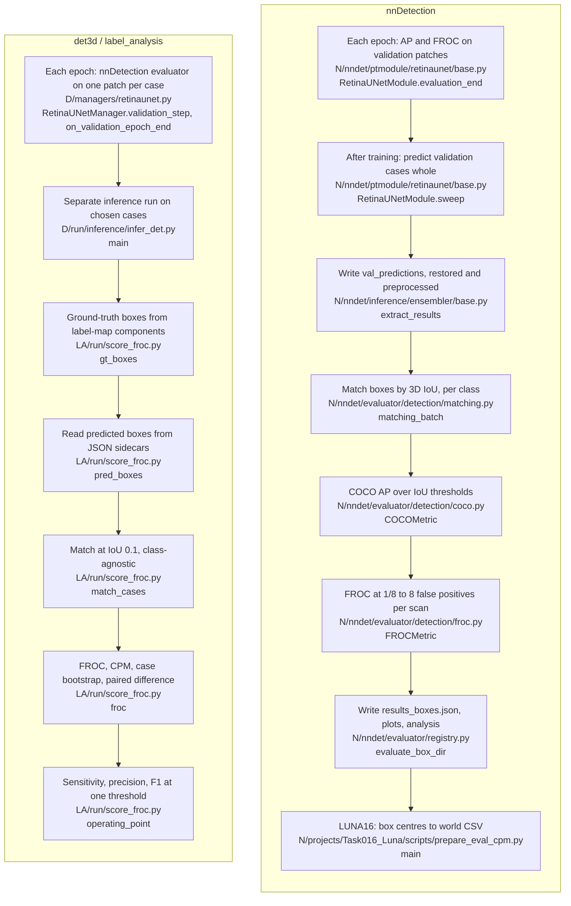

# Phase 7: evaluation

Index: [../nndetection-integration.md](../nndetection-integration.md).

Path prefixes: `N/` = `/home/ub/code/nnDetection/`, `D/` = `/home/ub/code/det3d/det3d/`, `LA/` = `/home/ub/code/label_analysis/label_analysis/`.

## 7.1 In-training metric

**nnDetection.** At the end of each validation epoch it matches predicted and true boxes per patch and reports mean AP over IoU thresholds 0.10 to 0.50 in steps of 0.05, AP at 0.1 and 0.5, and a FROC score at both. The mean AP is the monitored value and the sweep target.

**Rationale.** nnDetection reports mean AP at IoU 0.1 "reflecting clinical relevance regarding coarse localisation on medical images and the absence of overlapping objects in 3D images" (Baumgartner 2021, [nnDetection](https://arxiv.org/abs/2106.00817), Sec. 3, Benchmark), the choice made in Retina U-Net, which "respects the clinical need for coarse localization and also exploits the non-overlapping nature of objects in 3D" (Jaeger 2020, [Retina U-Net](https://arxiv.org/abs/1811.08661), Sec. 4.3). Independent evidence: a later paper from the same group repeats the reasoning, "emphasizing the diagnostic performance of the method and its ability to coarsely localize target objects" (Eckstein 2025, [Pre-training in 3D medical object detection](https://arxiv.org/abs/2509.15947), Metrics and Statistical Analysis). No stated rationale found for monitoring the mean over IoU 0.10 to 0.50.

**det3d today.** `retinaunet` uses the same evaluator and logs the same mean AP as `val0_metric`, on the validation patches of 4.7. `retinanet` uses MONAI's COCO metric and reports the plain mean of eight entries, with one class name for a three-class model.

**Home.** Exists (`RetinaUNetManager` in `D/managers/retinaunet.py`; `compute_coco_metrics` in `D/evaluation/coco.py`).

**Issues in det3d code.** C7, D8 in [issues.md](issues.md).

## 7.2 Whole-case validation scoring

**nnDetection.** With `--sweep`, training ends by predicting every validation case in full, writing the predictions in original and preprocessed space, and scoring them against the stored ground-truth boxes. The raw pre-fusion boxes are also kept so the sweep (6.6) can re-fuse them with other parameters without running the network again.

**Rationale.** The raw predictions are kept "to avoid multiple model prediction runs during the parameter sweeps" (nnDetection repository, [README](https://github.com/MIC-DKFZ/nnDetection/blob/main/README.md), Inference), and the inference parameters are "empirically optimized by evaluating the performance on the validation set" (Baumgartner 2021, [nnDetection](https://arxiv.org/abs/2106.00817), Fig. 1). No separate rationale for scoring whole validation cases was found.

**det3d today.** Two manual steps: an inference run over chosen cases, then `LA/run/score_froc.py` with a case list. Neither is started by training, and which run and fold produced a score is not recorded by the scorer. Pre-filter boxes are not kept.

**Home.** No natural home inside training. The two existing steps are `D/run/inference/infer_det.py` and `LA/run/score_froc.py`.

## 7.3 FROC

**nnDetection.** All matched and unmatched detections of all cases and classes are pooled; sensitivity is read at 1/8, 1/4, 1/2, 1, 2, 4 and 8 false positives per scan and averaged. A detection is a hit when its 3D IoU with an unmatched true box reaches the threshold (0.1 or 0.5); at most 100 detections per case and class. Upstream marks FROC as experimental and prefers AP.

**Rationale.** The FROC code states that the implementation "is experimental and might change in the future. Please prefer the AP metric for now" ([froc.py](https://github.com/MIC-DKFZ/nnDetection/blob/main/nndet/evaluator/detection/froc.py), docstring), and the README warns that for several classes "inter class calibration is important" because all predictions are pooled (nnDetection repository, [README](https://github.com/MIC-DKFZ/nnDetection/blob/main/README.md), Results). The seven false-positive rates and the average over them are the LUNA16 definition, which "defined one overall output score" as the average sensitivity at 1/8, 1/4, 1/2, 1, 2, 4 and 8 false positives per scan (Setio 2017, [LUNA16](https://arxiv.org/abs/1612.08012), Sec. 3.3). Independent evidence: "the FROC Score is often favoured in the clinical context due to its easier interpretability despite its lack of standardization", and those seven values are a potential default "as used for multiple popular benchmarks" (Maier-Hein 2024, [Metrics Reloaded](https://arxiv.org/abs/2206.01653), Suppl. Note 2, DG4.2).

**det3d today.** `score_froc.py` imports nnDetection's matching and FROC functions and uses IoU 0.1 with up to 1,000 detections. Its ground truth is built independently of training: one box per 26-connected component of the label map (any label above 0), ignoring components under 3 mm equivalent diameter. Training targets use a different rule (3.5: per-label components, 2 mm major-axis filter). Predicted classes are ignored. It adds a 10,000-sample case bootstrap and paired differences between systems, which upstream does not have.

**Home.** Exists (`LA/run/score_froc.py`).

**Issues in det3d code.** C2, C3 in [issues.md](issues.md).

## 7.4 Full AP and per-class metrics

**nnDetection.** The standalone evaluation (`nndet_eval`) reports AP over IoU 0.1 to 0.9, per class, with score histograms and an analysis folder per IoU and score setting. A case-level evaluator scores each case by its highest box score.

**Rationale.** The repository marks FROC as experimental and prefers AP (see 7.3), and AP "constitutes the undisputed standard metric for object detection and instance segmentation in the computer vision community" (Maier-Hein 2024, [Metrics Reloaded](https://arxiv.org/abs/2206.01653), Suppl. Note 2, DG4.2). The IoU 0.1 localisation criterion is justified under 7.1. The case-level evaluator is marked "experimental" in the README (nnDetection repository, [README](https://github.com/MIC-DKFZ/nnDetection/blob/main/README.md), Results); Retina U-Net notes that a patient-level score from the maximum box score "is blind to the issue of 'being right for the wrong reasons' and can further over-estimate performance due to class-imbalance on the patient-level" (Jaeger 2020, [Retina U-Net](https://arxiv.org/abs/1811.08661), Sec. 4.3). No stated rationale found for the full IoU range 0.1 to 0.9.

**det3d today.** None outside training. The offline scorer is class-agnostic FROC only.

**Home.** `LA/run/score_froc.py` is the only offline box scorer; no AP code lives there.

## 7.5 LUNA16 official scoring

**nnDetection.** For LUNA16 it trains ten folds, predicts each case with its own fold's model, takes each box centre, converts it to world coordinates with the image's own geometry, and writes the challenge's CSV (`seriesuid, coordX, coordY, coordZ, probability`). The official script, which is not in the repository, then scores it; by the published challenge definition a mark is a hit when it lies within the nodule's radius of its centre, and annotations not agreed by enough readers are excluded from both hits and false positives.

**Rationale.** LUNA16 annotations were "reduced to a center point plus radius" (Baumgartner 2021, [nnDetection](https://arxiv.org/abs/2106.00817), Sec. 3, Public leaderboard results), and the challenge counts a mark as a hit when it "is located within a distance r from the center of any nodule", with r set to the reference nodule's radius (Setio 2017, [LUNA16](https://arxiv.org/abs/1612.08012), Sec. 3.3). Annotations agreed by fewer than 3 of 4 readers, among others, are "irrelevant findings" and excluded from both hits and false positives (Setio 2017, [LUNA16](https://arxiv.org/abs/1612.08012), Sec. 2), because "they constitute pulmonary abnormalities that could be important for different clinical diagnosis" (Setio 2017, [LUNA16](https://arxiv.org/abs/1612.08012), Sec. 1). 

**det3d today.** None. The inference sidecar already stores each box in world coordinates (`bbox_world`), and `sidecar_to_mrk.py` converts sidecars to Slicer markups. LUNA16 is not a registered dataset.

**Home.** No natural home. What the step does: a converter from per-case sidecars to the challenge CSV, the official annotation and exclusion lists, and the official scoring script.
