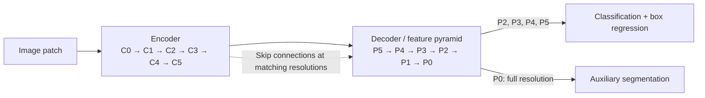

# BoxC002 — draft

Six-stage Retina U-Net example; architecture: [Jaeger et al., Figure 1 and §3.2](https://proceedings.mlr.press/v116/jaeger20a/jaeger20a.pdf#page=3). `BoxC002` plans the configuration; `RetinaUNetModule` constructs the network.

## Computed values

Planning: [Baumgartner et al., §2, Rule-based Parameters](https://arxiv.org/html/2106.00817#S2). Exact formulas below describe the implementation.

- **Encoder stages:** `C0…C5` are six resolution levels. Compute kernels and downsampling strides from patch size and spacing; delay downsampling on coarse axes and keep feature maps at least 4 voxels wide. Stage count is `num_resolutions = len(conv_kernels)`, computed inside `_plan_architecture()`.
- **Detection levels:** choose which decoder features feed the detection heads. For stage count `n`, use `range(min(max(1, n - 4), 2), n)`: five stages → `P1–P4`; six → `P2–P5` (`_plan_architecture()`).
- **Patch size:** start roughly cubic in millimetres, capped by median resampled image shape. If estimated training memory exceeds the target, shrink the patch and recompute the architecture (`_plan_architecture()`, `MemoryEstimatorDetection.estimate()`).
- **Anchors:** fit three sizes per axis to annotated boxes by maximizing mean best IoU; their Cartesian product gives `3³ = 27` anchors per position. Apply relative level-dependent scaling (`_plan_anchors()`). The 27-anchor configuration is described in [Baumgartner et al., §2, Fixed/Rule-based Parameters](https://arxiv.org/html/2106.00817#S2).

## Defaults

3D: batch size `4`; encoder channels `32–320`; pyramid/head channels `128`. Stage count and detection levels are derived values, not constructor arguments.

[Planning workflow](2-planning.md#BoxC002%20%E2%80%94%20class) · Implementation: `nndet/planning/architecture/boxes/c002.py` and inherited methods in `boxes/base.py`.
