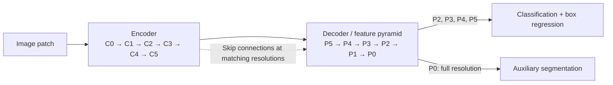
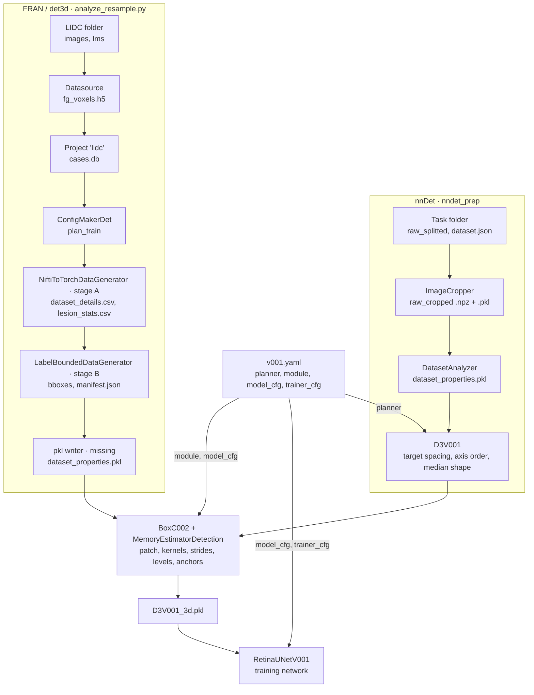

# BoxC002 — draft

Six-stage Retina U-Net example; architecture: [Jaeger et al., Figure 1 and §3.2](https://proceedings.mlr.press/v116/jaeger20a/jaeger20a.pdf#page=3). `BoxC002` plans the configuration; `RetinaUNetModule` constructs the network.

## Computed values

Planning: [Baumgartner et al., §2, Rule-based Parameters](https://arxiv.org/html/2106.00817#S2). Exact formulas below describe the implementation.

- **Encoder stages:** `C0…C5` are six resolution levels. Compute kernels and downsampling strides from patch size and spacing; delay downsampling on coarse axes and keep feature maps at least 4 voxels wide. Stage count is `num_resolutions = len(conv_kernels)`, computed inside `_plan_architecture()`.
- **Detection levels:** choose which decoder features feed the detection heads. For stage count `n`, use `range(min(max(1, n - 4), 2), n)`: five stages → `P1–P4`; six → `P2–P5` (`_plan_architecture()`).
- **Patch size:** start roughly cubic in millimetres, capped by median resampled image shape. If estimated training memory exceeds the target, shrink the patch and recompute the architecture (`_plan_architecture()`, `MemoryEstimatorDetection.estimate()`).
- **Anchors:** fit three sizes per axis to annotated boxes by maximizing mean best IoU; their Cartesian product gives `3³ = 27` anchors per position. Apply relative level-dependent scaling (`_plan_anchors()`). The 27-anchor configuration is described in [Baumgartner et al., §2, Fixed/Rule-based Parameters](https://arxiv.org/html/2106.00817#S2).

## Defaults

3D: batch size `4`; encoder channels `32–320`; pyramid/head channels `128`. Stage count and detection levels are derived values, not constructor arguments.

## Planner overview

`BoxC002` takes two inputs: data properties (`dataset_properties.pkl`) and the training recipe (`v001.yaml`). The recipe names the planner and the network class, and supplies `model_cfg`. The planner uses the network and `model_cfg` only to build trial networks for the memory estimate.

### Files

`N/` = `/home/ub/code/nnDetection/nndet/`; `F/` = `/home/ub/code/fran/fran/`; `D/` = `/home/ub/code/det3d/det3d/`.

| Step | Code | LIDC data |
|---|---|---|
| `v001.yaml` | `N/conf/train/v001.yaml`, composed under `N/conf/config.yaml` | — |
| Task folder | `N/conf/config.yaml` (`host` paths); environment in `/home/ub/code/nnDetection/scripts/nndet_env.sh` | `/r/datasets/nndet_data/Task012_LIDC/` (608 cases, fully prepared). `D/run/nndet/generate_nndet_plan_silo.sh` builds temporary task folders for other organs. |
| `ImageCropper` | `N/preprocessing/crop.py` | `/r/datasets/nndet_data/Task012_LIDC/raw_cropped/` |
| `DatasetAnalyzer` | `N/planning/analyzer.py`, `N/planning/properties/instance.py` | `/r/datasets/nndet_data/Task012_LIDC/preprocessed/properties/dataset_properties.pkl` |
| `D3V001` | `N/planning/experiment/v001.py`, `base.py` | — |
| `BoxC002` | `N/planning/architecture/boxes/c002.py`, `base.py`; `N/planning/estimator.py` | — |
| Plan | — | `/r/datasets/nndet_data/Task012_LIDC/preprocessed/D3V001_3d.pkl`; installed copy `/s/fran_storage/nndet_conf/plans/lungs/D3V001_3d.pkl` (per-organ list in `/s/fran_storage/nndet_conf/nndet_plan_paths.yaml`) |
| LIDC raw | registered in `/s/fran_storage/conf/datasets.yaml` | `/media/UB/datasets/lidc/` (`images/`, `lms/`) |
| `Datasource` | `F/data/datasource.py` | `/media/UB/datasets/lidc/fg_voxels.h5` |
| `Project` | `F/managers/project.py` | `/s/fran_storage/projects/lidc/` |
| `ConfigMakerDet` | `D/configs/parser.py` | `/home/ub/code/fran/configurations/experiment_configs_det.xlsx` |
| Stage A | `F/preprocessing/fixed_spacing.py` | `/t/fran_storage/datasets/preprocessed/lidc/fixed_spacing/spc_080_080_150/` (no `lesion_stats.csv` yet) |
| Stage B | `F/preprocessing/labelbounded.py` | `/r/datasets/preprocessed/lidc/lbd/spc_070_070_125_lbl1_ex000/` (older 0.7 mm build) |
| Raw lesion stats | `/home/ub/code/label_analysis/label_analysis/dataset_stats.py` | `/media/UB/datasets/lidc/label_analysis/lesion_stats.csv` |
| Model build | `D/configs/nndet_bridge.py`, `D/managers/helpers/nndet_retinaunet.py` | — |

### Calling sequence

**nnDet.** The top-level caller is `nndet_prep <task>`, which runs `scripts/preprocess.py:main`.

1. `main` → `compose()` builds one config from `config.yaml`, `train/v001.yaml`, `augmentation/base_more.yaml`, `prep/process.yaml` and any `-o` overrides. It adds `task`, and `data` from `dataset.json`.
2. `run` → `run_cropping_and_convert` → `ImageCropper.run_cropping`.
3. `run` → `run_dataset_analysis` → `DatasetAnalyzer.analyze_dataset(medical_instance_props())`.
4. `run` → `run_planning_and_process` picks `cfg["planner"]` (`D3V001`) and calls `D3V001.plan_experiment(cfg["module"], cfg["model_cfg"])`:
   - `plan_base` → target spacing and axis order.
   - `plan_base_stage` → median shape → `create_architecture_planner` → `BoxC002.plan()`.
   - `save_plan` → `D3V001_3d.pkl`. `run_preprocessing` then resamples the data with the plan.
5. Training: `nndet_train` composes the same config, loads the plan and builds `RetinaUNetV001(model_cfg, trainer_cfg, plan)`.

**FRAN / det3d.** The top-level caller is `F/run/preproc/analyze_resample.py --pipeline det -t lidc -p <plan>`.

1. `main` → `Project("lidc")` → `ConfigMakerDet.setup(plan)` → `plan_train`.
2. `process_plan` → `PreprocessingManager.resample_dataset` → `NiftiToTorchDataGenerator` (stage A).
3. When the plan mode is `lbd`: `PreprocessingManager.generate_lbd_dataset` → `LabelBoundedDataGenerator` (stage B).
4. Training: `D/run/training/train.py` → `TrainerDet` → `RetinaUNetManager` → `build_nndet_retinaunet_module`.
5. Nothing in det3d calls `BoxC002` yet. det3d builds the network from `plan_train` (`plan_from_det3d`).

### v001.yaml

- **Contents.** nnDet's training recipe. It names the planner (`D3V001`), network (`RetinaUNetV001`) and plan (`D3V001_3d`), and holds `augment_cfg` (data loading), `trainer_cfg` (optimiser, schedule, AMP) and `model_cfg` (decoder, head, sampler, matcher, segmenter).
- **What BoxC002 uses.** Only `module`, as `network_cls`, and `model_cfg`. `_plan_architecture` calls `network_cls.from_config_plan(model_cfg, plan_arch, plan_anchors)` to build each trial network for the memory estimate. `model_cfg` therefore affects the memory fit, and through it the patch size, but the planner reads no planned value from it.
- **Fixed or derived.** Every value is a constant; none comes from the data. The interpolations only copy values: `${augmentation}` from `augmentation/base_more.yaml`, batches per epoch from `trainer_cfg`, and `num_threads` from the `det_num_threads` environment variable. Data-derived values (patch size, batch size, architecture, anchors) live in the plan.
- **Override hook.** `model_cfg.plan_arch_overwrites` and `plan_anchors_overwrites` are empty by default. `from_config_plan` applies them on top of the plan, both in the memory estimate and at training.
- **Who builds or changes it.**
  - nnDet: `compose()` (`N/utils/config.py`) merges it through Hydra. `-o key=value` on `nndet_prep` or `nndet_train` overrides any key.
  - det3d: `load_nndet_train_cfgs()` (`D/configs/nndet_bridge.py`) reads the file with `yaml.safe_load`, so interpolations stay as strings. `build_nndet_trainer_cfg()` replaces learning rate, weight decay, momentum, Nesterov, benchmark and deterministic with FRAN `model_params`. `build_nndet_retinaunet_module()` sets `max_num_epochs`. `apply_det3d_plan_to_nndet_model_cfg()` replaces six matcher and sampler values with `plan_train` values.

### Step details

- **ImageCropper.** It expects nnDet's raw layout: `raw_splitted/imagesTr/<case>_0000.nii.gz`, an instance map `labelsTr/<case>.nii.gz`, and `labelsTr/<case>.json` mapping instance ids to classes. Semantic maps such as FRAN `lms` must first be split into instances with `nndet_seg2det`; the silo uses `D/run/nndet/convert_seg2det_local.py`. It crops each case to the nonzero image region and writes `<case>.npz` (image and instance map) and `<case>.pkl` (`original_spacing`, `size_after_cropping`, instance classes).
- **DatasetAnalyzer.** It runs the `medical_instance_props()` functions over the cropped cases: sizes and spacings, modalities, intensity statistics, and per-case boxes, counts and IoUs. All results go into `dataset_properties.pkl`.
- **D3V001.** Target spacing is the median spacing. A strongly anisotropic axis gets its 10th-percentile spacing instead (nnU-Net v2.1 rule). Axis order puts the coarsest axis first. Median shape is the median case shape after resampling.
- **BoxC002.** See Computed values above.

## Compatibility

Reuse existing callers; no new classes. Each cell names the producer as `Class` → method or function → output.

| BoxC002 input | nnDet | FRAN / det3d |
|---|---|---|
| Per-lesion boxes | `DatasetAnalyzer` → `iseg_to_boxes` | `Preprocessor.postprocess` → `lesion_stats.csv` |
| Per-case spacing | `ImageCropper.load_crop_from_list_of_files` | `ConfigMakerDet.setup` → `plan_train["spacing"]` |
| Lesion counts | `DatasetAnalyzer` → `count_instances` | `LabelBoundedDataGenerator._process_row` → `n_boxes` |
| Class list | `DatasetAnalyzer` → `analyze_instances` | `infer_det_labels_from_data_folder` → `fg_labels` |
| Median shape | `AbstractPlanner.plan_base_stage` | `Preprocessor._write_results_csv` → `dataset_details.csv` |
| Target spacing | `D3V001.determine_target_spacing` | `ConfigMakerDet.setup` → `plan_train["spacing"]` |
| Dims, input channels | `DatasetAnalyzer.analyze_dataset` → `get_modalities` | `ConfigMakerDet.setup` → `spatial_dims`, `n_input_channels` |
| Axis permutation | `D3V001.determine_forward_backward_permutation` | None; set `transpose_forward` in the caller |
| `network_cls`, `model_cfg` | `D3V001.create_architecture_planner` | `build_nndet_retinaunet_module` |
| Memory estimator | `D3V001.create_architecture_planner` → `MemoryEstimatorDetection` | None; reuse nnDet's |
| `dataset_properties.pkl` | `DatasetAnalyzer.analyze_dataset` | None; this is the only missing piece |

### Notes on sources

- **Boxes.** Stage A writes `lesion_stats.csv` at target spacing, before cropping, with `remapping_source` applied. It is off by default; set `FRAN_STORE_LABEL_STATS=1`. Each `bbox` is `[x, y, z, sx, sy, sz]`.
- **Other box sources.** Stage B `DetectionBBoxStatsd` writes `bboxes/<case>.csv` after remapping and dusting. For raw maps, label_analysis `lms_folder_statistics` has already written `/media/UB/datasets/lidc/label_analysis/lesion_stats.csv`.
- **Raw spacing.** `Datasource` stores each case's spacing as an HDF5 attribute.
- **Per-class counts.** `n_boxes` is one total per case. Group the box CSV by label to get counts per class.
- **Axes.** FRAN stage A is RAS x, y, z. Permute boxes, spacing and median shape together.
- **Pickle.** Write `<preprocessed_output_dir>/properties/dataset_properties.pkl` with `dim`, `modalities`, `class_dct`, `num_instances`, `all_ious`, `class_ious`, and per case `boxes`, `original_spacing`, `num_instances`. The planner never uses the two IoU keys, so empty placeholders are enough.

### Conversion and filtering

- Convert start+size boxes with `voxel_start_size_to_xyzxyz`, then `xyzxyz_exclusive_batch_to_nndet`. The result is `[x1, y1, x2, y2, z1, z2]`, shape `[N, 6]`.
- Before planning, apply the stage-B label remap to `label_org` and the dusting size filter to `major_axis`.
- Crop translations do not affect anchor fitting or the lesion-density estimate: these use centred boxes and pairwise centre distances respectively.
- `BaseBoxesPlanner.plan()` resets defaults; earlier attribute overrides are overwritten. Keep the segmentation setting consistent: `BoxC002` sets `seg_classes = classifier_classes`; det3d currently sets `seg_classes = 1`.
- Old lidca raw maps include lung-sized label `1`; map it to background before using those maps for lesion planning. Check the selected dataset's label meaning before applying that mapping.

[Planning workflow](2-planning.md#BoxC002%20%E2%80%94%20class) · Implementation: `nndet/planning/architecture/boxes/c002.py` and inherited methods in `boxes/base.py`.
